# Prompts utilizados

Fase 2 de LavaCampus (rama `mejora-ia`). Mejoras hechas con ayuda de IA sin romper la arquitectura MVVM + Repository: la View no usa DAO ni Repository, el ViewModel solo conoce la interface `LavaRepository`, toda función nueva se declara primero en la interface y cada cambio de entidad sube la versión de la base.

| Mejora del PDF | Prompt | Capas que cambiaron |
|---|---|---|
| Pedidos atrasados | 1 | DAO + Repository + ViewModel + View |
| Descuento por volumen | 2 | Entidad + Repository + ViewModel + View |
| Repetir un pedido | 3 | ViewModel + View |
| Gráfico de gasto mensual | 5 | DAO + Repository + ViewModel + View |
| Calificación del pedido | 10 | Entidad + DAO + Repository + ViewModel + View |
| Recibo del pedido | 11 | ViewModel + View |

Mejoras propias (además de las del PDF): límite de pedidos configurable (4), cambio de perfil seguro (6), diseño eléctrico con modo oscuro (7), registro de estudiantes con código automático (8) y revisión general (9).

Todas las capturas se tomaron en un celular Android real.

## Prompt 1 · Pedidos atrasados en la bandeja

**Texto enviado a la IA:**

> Tengo una app Kotlin con Jetpack Compose, Material 3, MVVM, Room y un LavaRepository (interface). Agrega en la bandeja del administrador una marca roja para los pedidos atrasados (fechaEntrega menor que hoy y estado distinto de ENTREGADO y CANCELADO). La consulta va en PedidoDao, la función en LavaRepository y su implementación, y el valor se expone como StateFlow en BandejaViewModel. La View solo lo muestra. Además, el panel debe contar los pedidos atrasados. No uses XML ni librerías externas. Muéstrame solo los archivos que cambian.

**Qué generó la IA:**

- `PedidoDao.observarAtrasados(hoy)`: consulta `SELECT id FROM pedidos WHERE fechaEntrega < :hoy AND estado NOT IN ('ENTREGADO', 'CANCELADO')` que devuelve `Flow<List<Int>>`.
- `LavaRepository.observarPedidosAtrasados(hoy)` declarada en la interface y su implementación en `LavaRepositoryRoom`.
- `BandejaViewModel.atrasados: StateFlow<Set<Int>>` con la fecha de hoy (`LocalDate.now()`).
- `PanelViewModel.atrasados: StateFlow<Int>` con la cantidad.
- `BandejaScreen`: borde rojo y el texto "Atrasado · debía entregarse el …" en las tarjetas atrasadas.
- `PanelScreen`: tarjeta roja "N pedidos atrasados" con botón "Ver" que abre la bandeja.

**Segundo prompt (mejora):**

> Mejora la bandeja: agrega un chip "Atrasados (N)" que muestre solo los pedidos atrasados, ordena los atrasados primero y muestra cuántos días de atraso lleva cada uno. El filtro y el cálculo de días van en BandejaViewModel; la View solo los muestra.

**Qué generó la IA en la mejora:**

- `BandejaViewModel`: `soloAtrasados`, `verAtrasados()`, `diasAtraso(p)` con `ChronoUnit.DAYS` y el `combine` de 5 flujos (pedidos, estado, búsqueda, solo atrasados e ids atrasados) que ordena los atrasados primero.
- `BandejaScreen`: chip rojo "Atrasados (N)" y el texto "Atrasado 2 días · debía entregarse el …".

**Qué tuve que corregir yo:**

- El callback del panel se llamaba `onVerListos`, pero ahora también abre la bandeja desde la alerta de atrasados; lo renombré a `onVerPedidos`.
- Al elegir un chip de estado había que apagar el filtro de atrasados; si no, quedaban dos chips marcados a la vez.
- El flujo de ids atrasados se declaraba después de `pedidos` y el `combine` lo usaba antes de inicializarse; lo moví arriba.
- Revisé que la fecha se compare como texto `aaaa-MM-dd`, que sí ordena bien porque así se guarda en la tabla.

**¿Respeta MVVM?:** Sí. La consulta está en el DAO, la función se declaró primero en la interface `LavaRepository`, el ViewModel solo usa la interface y la View solo muestra el `StateFlow`. No cambió ninguna entidad, así que no hizo falta subir la versión de la base.

**Capturas:**

| Bandeja con el pedido atrasado en rojo | Panel con el aviso de pedidos atrasados |
| :---: | :---: |
| 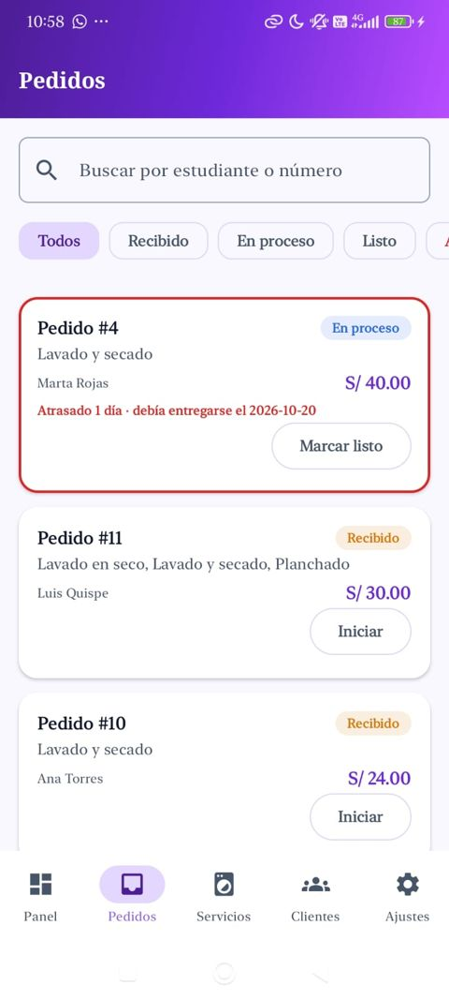 | 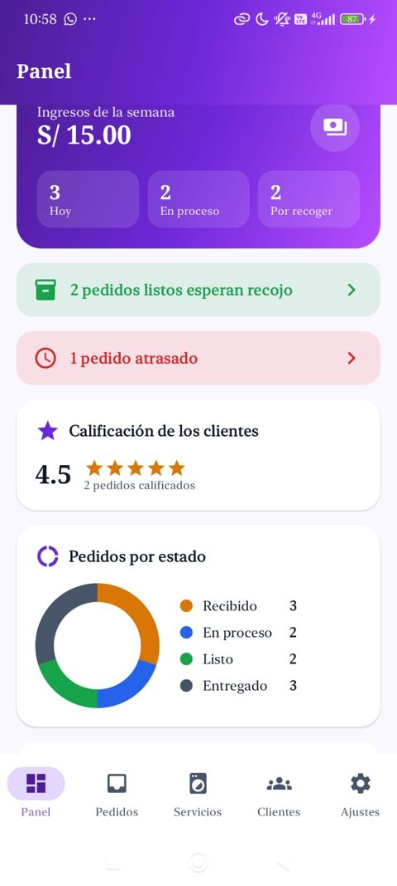 |

## Prompt 2 · Descuento por volumen

**Texto enviado a la IA:**

> En LavaCampus (Kotlin, Compose, MVVM, Room, LavaRepository como interface) agrega un descuento por volumen: si los kilos de lavado (servicios con unidad KG) superan 5 kg, se aplica 10 % de descuento sobre el subtotal del lavado. El descuento debe verse en el resumen de Nuevo pedido y guardarse en el pedido. La regla va en NuevoPedidoViewModel; agrega el campo en la entidad Pedido y sube la versión de la base; el repository solo guarda el descuento dentro de la transacción. Muestra el descuento también en el detalle del estudiante y en la gestión del administrador.

**Qué generó la IA:**

- `Pedido.descuento: Double = 0.0` y `LavaDatabase` pasa a `version = 3`.
- `LavaRepository.crearPedido(..., descuento)`: primero en la interface y luego en `LavaRepositoryRoom`, que guarda `total = suma de subtotales - descuento` dentro de `withTransaction`.
- `NuevoPedidoViewModel`: `subtotal`, `kilosLavado`, `descuento` y `total` como `StateFlow`, con la regla en `calcularDescuento()` y las constantes `KILOS_PARA_DESCUENTO = 5.0` y `PORCENTAJE_DESCUENTO = 0.10`.
- `NuevoPedidoScreen`: líneas de subtotal y "Descuento por volumen (10 % del lavado)" en verde, y la pista "Lava más de 5 kg y obtén 10 % de descuento".
- `DetallePedidoScreen` y `GestionPedidoScreen` muestran el descuento guardado.

**Qué tuve que corregir yo:**

- Verifiqué que el 10 % se aplique solo al subtotal del lavado por kilo y no al planchado ni al lavado en seco.
- Verifiqué el límite: la regla dice "supera 5 kg", así que con 5.0 kg exactos no hay descuento y con 5.5 kg sí.

**¿Respeta MVVM?:** Sí. La regla de negocio vive en el ViewModel, el Repository solo guarda el valor, la entidad cambió y por eso se subió la versión de la base (3), y las pantallas solo muestran los `StateFlow`.

**Capturas:**

| Resumen con la pista del descuento por volumen |
| :---: |
| 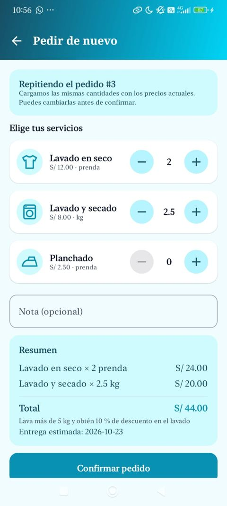 |

## Prompt 3 · Repetir un pedido

**Texto enviado a la IA:**

> En LavaCampus (Kotlin, Compose, MVVM, Room, LavaRepository como interface) agrega "Repetir un pedido": en la pestaña Historial de Mis pedidos, cada pedido tiene un botón "Pedir de nuevo" que abre Nuevo pedido con las mismas cantidades del pedido anterior, pero calculadas con los precios actuales. Si un servicio ya no está activo, no se carga y se avisa. La carga va en NuevoPedidoViewModel usando las funciones que ya existen en el repository; la View solo muestra. Pasa el id del pedido como argumento opcional de la ruta.

**Qué generó la IA:**

- `Rutas.NUEVO_PEDIDO = "nuevo_pedido?repetir={repetir}"` y `Rutas.nuevoPedido(repetir)`; en `NavLava` el argumento `repetir` es opcional (`defaultValue = 0`) y el título cambia a "Pedir de nuevo".
- `NuevoPedidoViewModel(repo, usuarioId, prefs, repetirId)`: en `init` llama a `cargarPedidoAnterior()`, que lee el pedido con `observarPedido(id).first()` y los servicios activos con `observarServiciosActivos().first()`, y llena las cantidades. El total, el descuento y la fecha se recalculan solos con los precios actuales.
- `MisPedidosScreen`: botón "Pedir de nuevo" en cada pedido del Historial.
- `NuevoPedidoScreen`: tarjeta "Repitiendo el pedido #N" que explica que se usan los precios actuales.

**Qué tuve que corregir yo:**

- Verifiqué que no se agregara ninguna función nueva al repository: se reutilizan `observarPedido` y `observarServiciosActivos`, como pide el PDF (solo ViewModel + View).
- Las cantidades se limitan al máximo del servicio (10 kg o 30 prendas) por si el pedido viejo tenía más.
- Las llamadas a `nav.navigate(Rutas.NUEVO_PEDIDO)` usaban el texto de la plantilla con `{repetir}`; las cambié a `Rutas.nuevoPedido()`.

**¿Respeta MVVM?:** Sí. La carga y las reglas están en el ViewModel, que solo usa la interface `LavaRepository`; la pantalla solo muestra el estado. No cambió ninguna entidad.

**Capturas:**

| Historial con el botón Pedir de nuevo | Pedido repetido con los precios actuales |
| :---: | :---: |
| 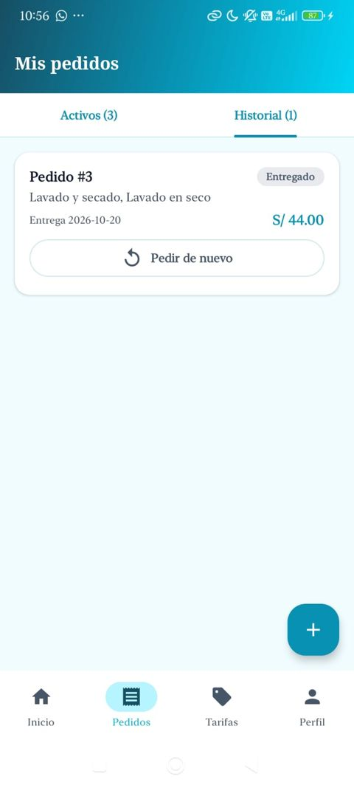 |  |

## Prompt 4 · Límite de pedidos activos configurable

**Texto enviado a la IA:**

> En LavaCampus el límite de 3 pedidos activos por estudiante está fijo. Haz que el administrador lo pueda cambiar desde Ajustes con un selector de 1 a 5, guardado en DataStore (PreferenciasStore) y con 3 por defecto para no romper la regla original. NuevoPedidoViewModel debe usar el valor guardado y el mensaje debe decir el número correcto. Tarifas debe mostrar el límite actual. Respeta MVVM.

**Qué generó la IA:**

- `PreferenciasStore`: clave `limitePedidos` (por defecto 3), `Flow` de lectura y `guardarLimitePedidos()`.
- `SesionViewModel`: `limitePedidos: StateFlow<Int>` y `cambiarLimitePedidos(n)`, que solo acepta valores de 1 a 5.
- `NuevoPedidoViewModel`: `limite: StateFlow<Int>`; al confirmar compara `contarActivos()` con el límite y muestra "Ya tienes N pedidos activos".
- `AjustesScreen`: tarjeta "Máximo de pedidos activos" con botones segmentados 1 · 2 · 3 · 4 · 5.
- `TarifasScreen`: la regla dice "Máximo N pedidos activos por estudiante".

**Qué tuve que corregir yo:**

- El mensaje con 1 decía "1 pedidos activos"; agregué el singular "1 pedido activo".
- Validé que el ViewModel no guarde valores fuera de 1 a 5 aunque la pantalla solo ofrezca esas opciones.

**¿Respeta MVVM?:** Sí. Es una preferencia pequeña, así que va en DataStore y no en Room; la regla de comparación está en el ViewModel y las pantallas solo muestran el valor. No cambió ninguna entidad.

**Capturas:**

| Ajustes: máximo de pedidos activos de 1 a 5 | Tarifas muestra el límite vigente |
| :---: | :---: |
| 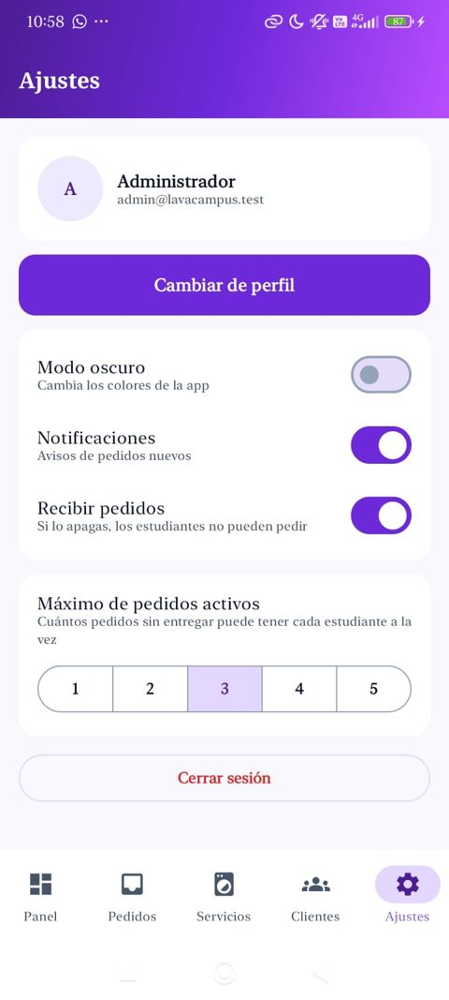 | 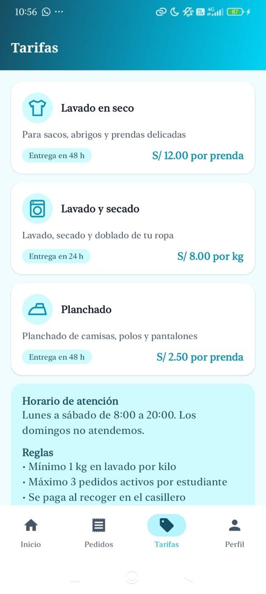 |

## Prompt 5 · Gráfico de gasto mensual

**Texto enviado a la IA:**

> En LavaCampus (Kotlin, Compose, MVVM, Room, LavaRepository como interface) agrega en el Perfil del estudiante un gráfico de líneas con lo que gastó cada mes (pedidos pagados). Crea la consulta con GROUP BY por mes en PedidoDao, decláralo en LavaRepository y su implementación, y en el ViewModel conviértelo a List<DatoGrafico> con los últimos 6 meses (0 si un mes no tuvo gasto). Crea GraficoLineas con Canvas en ui/components/graficos, con el mismo estilo que GraficoDona y GraficoBarras. La View solo lo muestra.

**Qué generó la IA:**

- `model/GastoMensual(mes, total)`.
- `PedidoDao.observarGastoMensual(usuarioId)`: `SELECT substr(fechaRegistro, 1, 7) AS mes, SUM(total) AS total ... WHERE pagado = 1 GROUP BY mes`.
- `LavaRepository.observarGastoMensual()` en la interface y en `LavaRepositoryRoom`.
- `MisPedidosViewModel.gastoMensual`: los últimos 6 meses con `YearMonth`, etiquetas en español ("may", "jun", …, "oct") y 0 en los meses sin gasto.
- `GraficoLineas`: líneas guía, área con degradado, línea con puntas redondeadas y puntos en cada mes.
- `PerfilScreen`: tarjeta "Gasto por mes" con el total de los 6 meses y el gráfico.

**Qué tuve que corregir yo:**

- `getDisplayName` en español devuelve "oct." con punto; lo quité para que las etiquetas se vean limpias.
- Usé `Locale.forLanguageTag("es")` en lugar del constructor `Locale("es")`, que está obsoleto.
- Si el estudiante solo tiene pedidos de un mes, la línea quedaba como un punto suelto; por eso se rellenan los 6 meses con 0.

**¿Respeta MVVM?:** Sí. La consulta está en el DAO, la función se declaró primero en la interface, la conversión a datos del gráfico se hace en el ViewModel y el Composable solo dibuja. No cambió ninguna entidad (`GastoMensual` es un modelo de resultado, no una tabla).

**Capturas:**

| Gráfico de gasto mensual (modo claro) | Gráfico de gasto mensual (modo oscuro) |
| :---: | :---: |
| 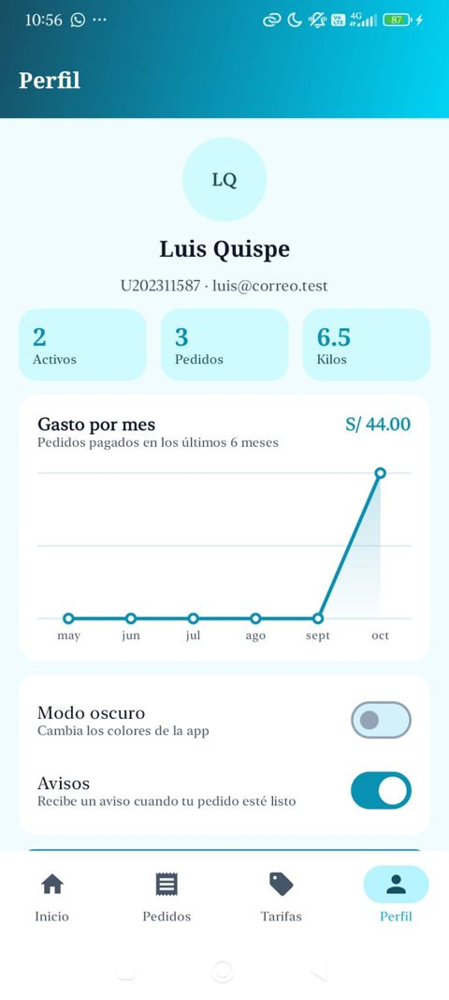 | 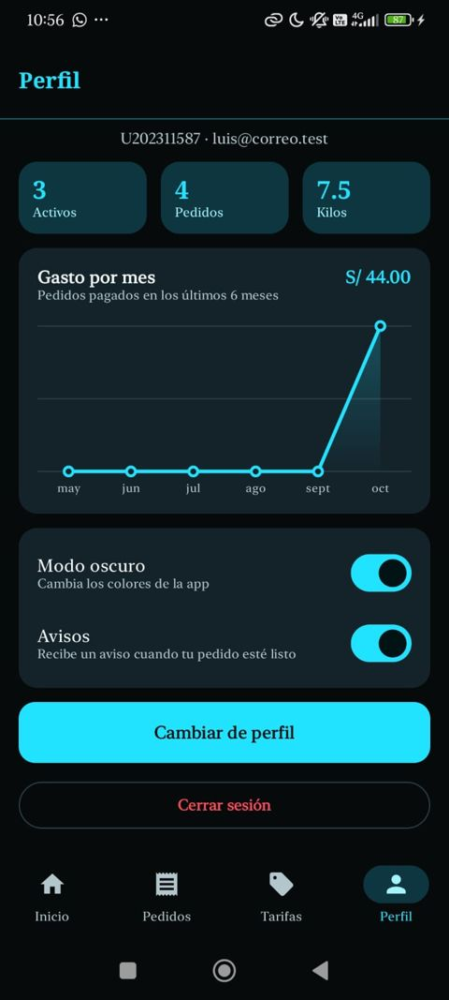 |

## Prompt 6 · Cambio de perfil seguro

**Texto enviado a la IA:**

> En LavaCampus, "Cambiar de perfil" entra directo con el primer usuario del otro rol (siempre Ana o siempre el administrador) sin pedir contraseña. Corrígelo: al cambiar de perfil se cierra la sesión actual y se abre el Login con la pestaña del otro rol ya seleccionada; al iniciar sesión se guarda el perfil en DataStore y se navega a su grafo limpiando la pila. Quita del repository lo que ya no se use.

**Qué generó la IA:**

- `SesionViewModel.cambiarPerfil()` ya no busca un usuario: guarda el otro rol en `rolLogin` y cierra la sesión.
- `NavLava`: Cambiar de perfil navega a `LOGIN` con `popUpTo(nav.graph.id) { inclusive = true }`.
- `LoginScreen` arranca con la pestaña de `vm.rolLogin`.
- Se eliminaron `UsuarioDao.obtenerPorRol` y `LavaRepository.obtenerUsuarioPorRol`, que ya no se usaban.

**Qué tuve que corregir yo:**

- La primera versión (la mía, de la Fase 1) dejaba que un estudiante entrara como administrador sin contraseña; lo detecté al probar en el celular.
- Verifiqué que al cambiar de perfil se borre el mensaje de error anterior del login.

**¿Respeta MVVM?:** Sí. La decisión de qué rol mostrar está en el ViewModel; la pantalla solo lee `rolLogin`. Se quitó una función de la interface y de su implementación al mismo tiempo.

**Capturas:**

| Login con selector de rol |
| :---: |
| 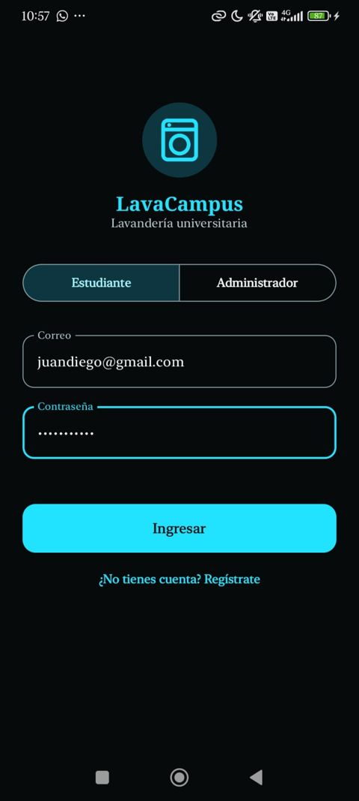 |

## Prompt 7 · Diseño eléctrico oscuro y nuevo Panel

**Primeros intentos:**

> Mejora el diseño sin perder el estilo del PDF (turquesa #0891B2 y violeta #6D28D9)… prueba colores eléctricos… muéstrame opciones de estilo… prueba un "encabezado grande" con tonos oscuros.

Probé varias opciones visuales con la IA (degradado eléctrico, neón oscuro, sólido, encabezado grande). El encabezado grande no me convenció al verlo en el celular, así que volví al paso anterior.

**Prompt final:**

> Haz lo que pide el PDF pero más bonito: los colores del PDF en versión eléctrica oscura. En modo claro, un degradado que empiece en el tono oscuro del rol, pase por el color del PDF y termine en neón. En modo oscuro, fondo casi negro con textos y bordes neón. Además, el Panel del administrador no me gusta: hazlo más claro, con los ingresos en grande, los contadores juntos, avisos compactos y gráficos ordenados. No cambies la lógica.

**Último ajuste (con una paleta de referencia):**

> Analiza esta paleta oscura eléctrica que me gusta (fondo #070908, tarjetas #101512, bordes #1F2924, texto #F5F8F6 / #9EB0A6 / #71857A, un solo acento brillante, verde #2EE58A con fondo #0A2817 y rojo #FF4A5E con fondo #330A10, títulos con serifa en negrita y texto sans-serif) y aplica la misma idea a LavaCampus, pero con el turquesa y el violeta del PDF como acento.

La IA explicó que lo "eléctrico" viene de: negros teñidos con el color del acento, un solo acento muy brillante, tres niveles de texto, estados con fondo oscuro teñido y texto claro, y la mezcla de títulos con serifa y texto sans-serif.

**Qué generó la IA:**

- Modo oscuro con negros teñidos por rol: estudiante `#060A0B / #0E1517 / #1C282B` con acento `#22E3FF`, administrador `#08070B / #121018 / #241F2E` con acento `#C08CFF`; tres niveles de texto por rol.
- `EstadoPedidoChip` en oscuro: fondo teñido y texto claro por estado (Listo `#0A2817` + `#9BF0C2`, Cancelado `#330A10` + `#FFB8C2`, etc.).
- `Type.kt`: títulos con serifa en negrita (`FontFamily.Serif`) y texto en `FontFamily.SansSerif`, sin librerías externas.
- La app arranca en modo oscuro (se puede cambiar a claro en Perfil o Ajustes).
- `Color.kt` y `Theme.kt`: los 4 esquemas completos de Material 3 (estudiante y admin, claro y oscuro), acentos neón (`#00D4F5` y `#B84DFF`) y fondo oscuro `#060A13`.
- `degradadoElectrico()`: en claro va del tono oscuro del rol al color del PDF y al neón (`#164E63 → #0891B2 → #00D4F5` y `#4C1D95 → #6D28D9 → #B84DFF`); en oscuro es el contenedor sólido del rol.
- `AppTopBar`: degradado en claro; en oscuro, fondo `#0B1220` con título neón y una línea neón debajo.
- Colores de estado que cambian solos a neón en modo oscuro (`EstadoListo`, `EstadoCancelado`… como getters `@Composable`).
- `Type.kt`: escala tipográfica completa con sans-serif fija.
- `PanelScreen` rediseñado: tarjeta grande con degradado con los ingresos y los 3 contadores dentro, avisos compactos con ícono que llevan a la bandeja, y secciones con ícono para la dona y las barras.

**Qué tuve que corregir yo:**

- Los primeros cambios casi no se notaban; pedí opciones visuales para elegir antes de tocar el código, y descarté el "encabezado grande" después de probarlo.
- En mi celular la letra salía con serifa porque `FontFamily.Default` usa la fuente del sistema; se fijó `FontFamily.SansSerif`.
- La barra inferior salía lila porque Material 3 usaba sus colores por defecto en `secondaryContainer` y `surfaceContainer`; ahora están definidos por rol.
- En modo oscuro el gris de "Entregado" y el azul de "En proceso" casi no se veían; por eso se agregaron versiones neón.
- `PanelViewModel` no sabe si el tema es oscuro, así que la dona se recolorea en la pantalla con `colorEstado(estado, oscuro)`.
- En el Login el logo "crecía y bajaba" al cambiar entre Estudiante y Administrador: el contenido estaba centrado y el enlace "Regístrate" y el mensaje de error aparecían y desaparecían. Ahora el contenido arranca arriba y esos elementos tienen un espacio fijo; también se quitó el ✓ del botón segmentado que cambiaba el ancho.

**¿Respeta MVVM?:** Sí. Solo cambiaron el tema y la capa de vista (y el valor por defecto del modo oscuro en `PreferenciasStore`); ningún ViewModel, Repository ni DAO cambió por el diseño.

**Capturas:**

| Inicio del estudiante | Panel en modo claro | Panel en modo oscuro |
| :---: | :---: | :---: |
| 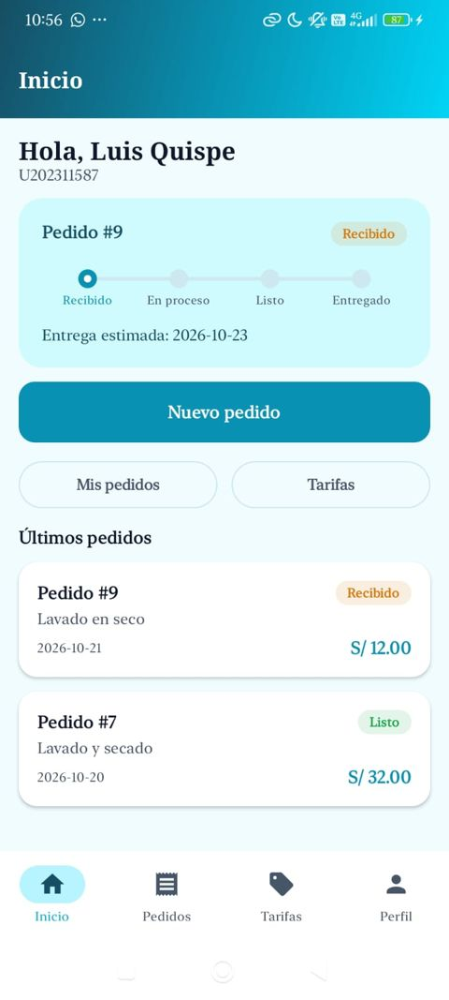 |  | 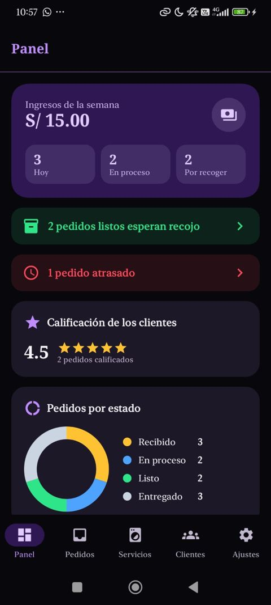 |

## Prompt 8 · Registro de estudiantes

**Texto enviado a la IA:**

> En LavaCampus el estudiante solo puede iniciar sesión con cuentas de prueba. Agrega "Crear cuenta" para estudiantes: nombre, correo, contraseña y repetir contraseña, guardado en la tabla usuarios de Room con rol CLIENTE. El código de estudiante no lo escribe el usuario: se genera solo y no se repite. Valida campos vacíos, formato del correo, contraseña mínima, que coincidan y que el correo no esté registrado. Al registrarse entra directo a su Inicio. Respeta MVVM: consultas en UsuarioDao, funciones en LavaRepository y su implementación, reglas en el ViewModel.

**Qué generó la IA:**

- `UsuarioDao`: `insertar(u): Long`, `contarPorCorreo(correo)` y `contarPorCodigo(codigo)`.
- `LavaRepository`: `registrarUsuario()`, `existeCorreo()` y `existeCodigo()`, declaradas primero en la interface y luego en `LavaRepositoryRoom`.
- `SesionViewModel.registrar(...)`: valida todo, genera el código con `generarCodigo()` (formato `U` + año + 5 números, por ejemplo `U202648213`, repitiendo hasta que no exista), guarda el usuario, guarda la sesión en DataStore y deja al nuevo usuario como `usuarioActual`; `errorRegistro` muestra el motivo.
- `RegistroScreen` y la ruta `REGISTRO`; en el Login, el enlace "¿No tienes cuenta? Regístrate" (solo en la pestaña Estudiante).

**Qué tuve que corregir yo:**

- La primera versión pedía escribir el código de estudiante a mano; no tiene sentido que el alumno lo invente, así que se quitó el campo y se genera automáticamente.
- Las expresiones regulares tenían `\s` dentro de un `String` normal de Kotlin, que no compila; las cambié a raw strings `"""..."""`.
- El correo se guarda en minúsculas y sin espacios para que no se pueda registrar dos veces el mismo con mayúsculas distintas.
- Solo los estudiantes pueden registrarse; las cuentas de administrador no se crean desde la app.

**¿Respeta MVVM?:** Sí. La pantalla solo envía los datos; las reglas están en el ViewModel, que usa la interface `LavaRepository`. No cambió ninguna entidad (se usan los mismos campos de `Usuario`), así que no hizo falta subir la versión de la base.

**Capturas:**

| Crear cuenta: el código se genera solo | Enlace Regístrate en el login |
| :---: | :---: |
| 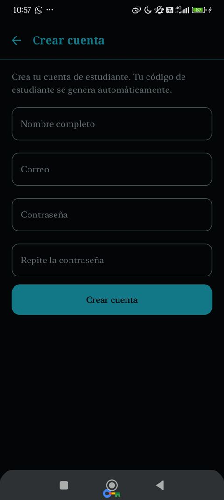 |  |

## Prompt 9 · Revisión general y contraste del modo oscuro

**Texto enviado a la IA:**

> Con una cuenta nueva creé un pedido y desde Pedidos ya no puedo volver a Inicio con la barra inferior. En la bandeja del administrador, si elijo "Recibido" y luego "Todos", la lista empieza desde el medio. Revisa que todo el proyecto funcione. En modo oscuro las tarjetas casi no se distinguen del fondo: que se note mejor sin cambiar los colores.

**Qué generó la IA:**

- `NavLava.irPestana()`: si la pestaña es la raíz (Inicio o Panel) hace `popBackStack(raiz, false)`; para las demás navega con `popUpTo(raiz)` y `launchSingleTop`, sin `saveState/restoreState`.
- `BandejaScreen`: `rememberLazyListState()` y un `LaunchedEffect` que vuelve al primer elemento cuando cambia el filtro, la búsqueda o la lista.
- `Color.kt`: en modo oscuro, tarjetas, bordes, contenedores y texto secundario un poco más claros (por ejemplo tarjeta del estudiante `#14222A` y borde `#2A3F47`; tarjeta del admin `#1C1828` y borde `#362E48`), manteniendo los mismos acentos neón.
- Revisión de los 72 archivos Kotlin: llaves y paréntesis balanceados, sin imports rotos, sin comentarios ni `TODO()`.

**Qué tuve que corregir yo:**

- El error de la barra inferior venía de `saveState = true` + `restoreState = true` con `popUpTo` hacia la misma pestaña raíz: al tocar Inicio se restauraba la pila guardada, que era Pedidos.
- En la bandeja, el `LaunchedEffect` solo con el filtro se ejecutaba antes de que llegara la lista nueva; se agregó como clave el primer pedido de la lista.
- La IA propuso rediseñar las secciones del Panel (dona con total al centro y bloques por estado); lo probé y preferí volver a la versión anterior del Panel.

**¿Respeta MVVM?:** Sí. Los arreglos son de navegación, de la vista y del tema; los datos siguen saliendo de los ViewModels.

**Capturas:**

| Gestión: seguimiento de costado y casilleros en cuadrícula | Tarifas ordenadas |
| :---: | :---: |
| 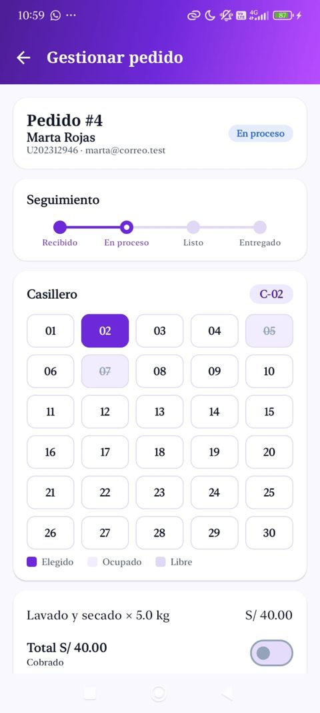 |  |

## Prompt 10 · Calificación del pedido

**Texto enviado a la IA:**

> En LavaCampus (Kotlin, Compose, MVVM, Room, LavaRepository como interface) agrega la calificación del pedido: cuando un pedido está ENTREGADO, el estudiante lo califica de 1 a 5 estrellas desde el detalle, y el Panel del administrador muestra el promedio y cuántos pedidos fueron calificados. Agrega el campo a la entidad y sube la versión de la base; consultas en PedidoDao, funciones en LavaRepository y su implementación, reglas en el ViewModel.

**Qué generó la IA:**

- `Pedido.calificacion: Int = 0` y `LavaDatabase` pasa a `version = 4`.
- `PedidoDao`: `calificar(id, estrellas)`, `observarPromedioCalificacion()` con `AVG(calificacion)` y `contarCalificados()`, ambos solo con `calificacion > 0`.
- `LavaRepository`: `calificarPedido()`, `observarPromedioCalificacion()` y `observarCantidadCalificados()`, primero en la interface y luego en `LavaRepositoryRoom`.
- `DetallePedidoViewModel`: `puedeCalificar` (solo ENTREGADO) y `calificar(n)`, que rechaza valores fuera de 1 a 5.
- `PanelViewModel`: `promedioCalificacion` y `cantidadCalificados`.
- `DetallePedidoScreen`: tarjeta "¿Qué tal tu pedido?" con 5 estrellas; `PanelScreen`: sección "Calificación de los clientes" con el promedio y las estrellas.
- `DatosIniciales`: dos pedidos entregados ya calificados (4 y 5) para que el Panel muestre un promedio desde el inicio.

**Qué tuve que corregir yo:**

- `AVG` devuelve `null` cuando no hay calificaciones; el ViewModel lo convierte a 0.0 y la pantalla muestra "Aún no hay pedidos calificados".
- La regla de "solo entregados" quedó en el ViewModel y no en la pantalla, aunque la pantalla también oculta las estrellas.

**¿Respeta MVVM?:** Sí. Cambió la entidad y se subió la versión de la base; la consulta está en el DAO, las funciones se declararon primero en la interface y la regla está en el ViewModel.

**Capturas:**

| Panel con la calificación promedio |
| :---: |
| 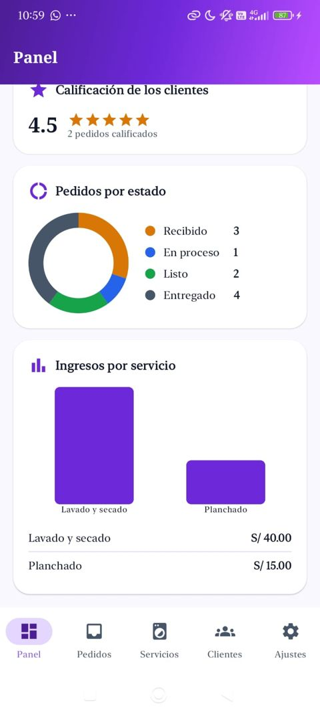 |

## Prompt 11 · Recibo del pedido

**Texto enviado a la IA:**

> Agrega una pantalla de recibo del pedido con el detalle completo (estudiante, código, fechas, casillero, servicios, descuento, total y pago) y un botón para compartirlo como texto. El texto del recibo lo arma el ViewModel; la pantalla solo lo muestra y lo comparte con un Intent.

**Qué generó la IA:**

- `DetallePedidoViewModel.textoRecibo()`: arma el recibo en texto con todas las líneas, el descuento, el total, el pago y el casillero.
- `ReciboScreen`: recibo con logo, estado, datos del estudiante, servicios, total y botón "Compartir recibo" con `Intent.ACTION_SEND` y `createChooser`.
- Ruta `recibo/{id}` y el botón "Ver recibo" en el detalle del pedido.

**Qué tuve que corregir yo:**

- Reutilicé `DetallePedidoViewModel` en lugar de crear otro ViewModel, porque ya tiene el pedido observado.
- El `Intent` se crea en la pantalla porque necesita el `Context`; el ViewModel solo entrega el texto, así no conoce nada de Android.

**¿Respeta MVVM?:** Sí. El ViewModel arma el contenido y la View solo lo muestra y lanza el Intent para compartir. No cambió ninguna entidad.

## Reflexión

- **¿Qué mejoró la IA y qué no?** Me ahorró tiempo en las consultas SQL (`GROUP BY`, `AVG`, `COALESCE`), en los gráficos con Canvas y en el tema de colores; lo que no hizo bien a la primera fue el diseño: varias propuestas casi no se notaban y tuve que pedir opciones visuales para elegir.
- **¿Qué errores cometió?** Usó `saveState/restoreState` en la barra inferior y eso impedía volver a Inicio; escribió expresiones regulares que no compilaban en Kotlin; y al principio dejaba entrar al otro perfil sin contraseña. Todo lo detecté probando la app en mi celular.
- **¿Qué aprendí sobre MVVM?** Que la regla de negocio va en el ViewModel y no en la pantalla: así pude cambiar el diseño muchas veces sin tocar la lógica del descuento, del límite de pedidos ni de la calificación.
- **¿Qué aprendí sobre Room?** Que cada cambio en una entidad obliga a subir la versión de la base (llegó a la 4), que `Flow` actualiza la pantalla sola y que `withTransaction` evita pedidos sin detalles.
- **¿Qué aprendí sobre reglas de negocio?** Que hay que revisar los casos límite (exactamente 5 kg, el domingo, un casillero ocupado, un correo repetido) y que la IA no los revisa sola: tengo que pedirlos y probarlos yo.

