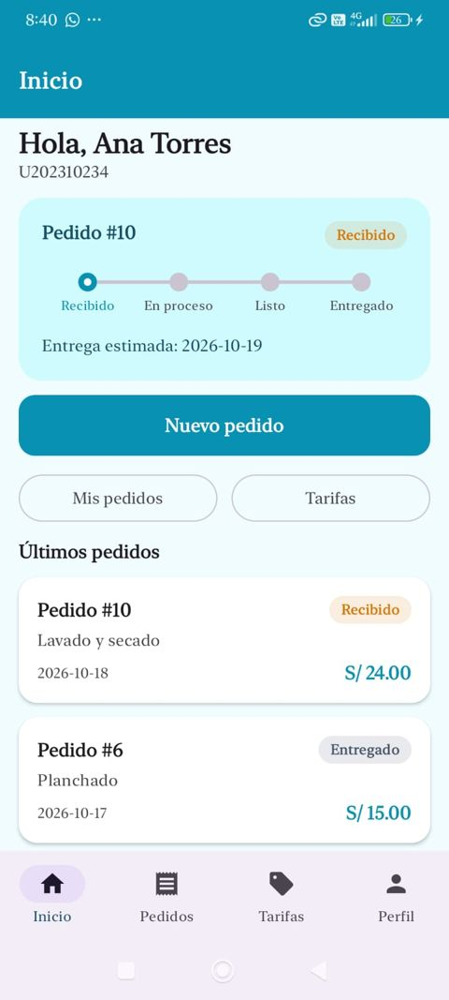
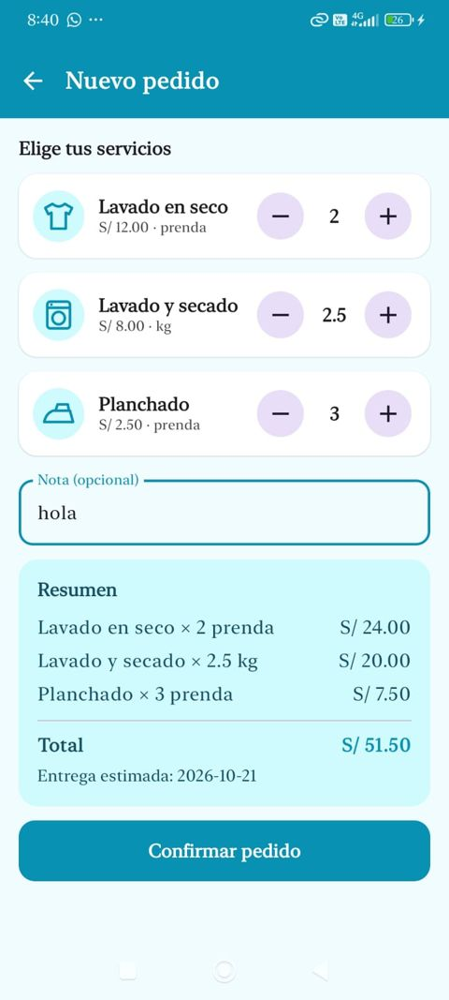
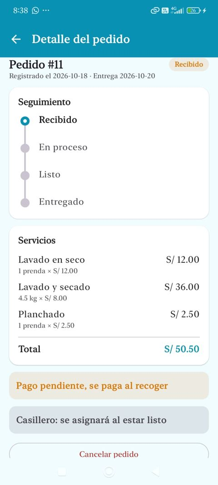
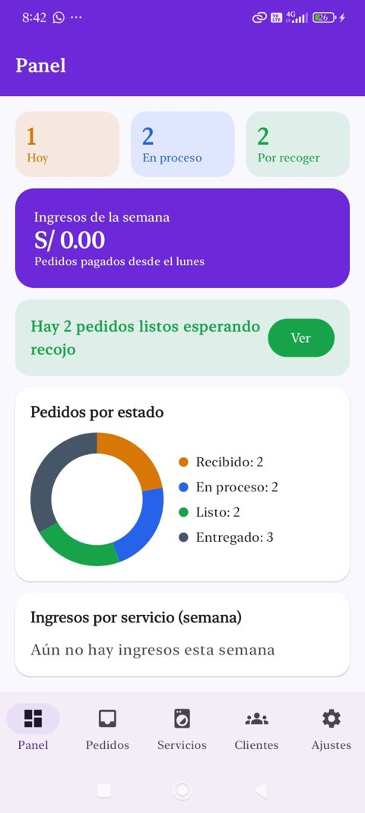
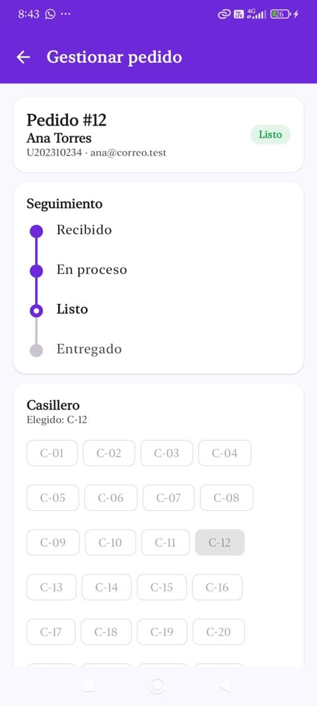
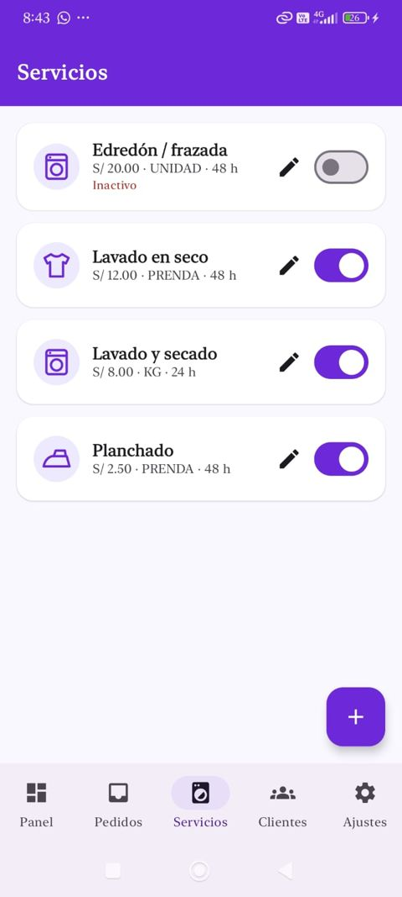

# LavaCampus

App de la lavandería de un campus universitario, hecha con **Kotlin + Jetpack Compose + Material 3**, **Room**, **DataStore** y **Navigation Compose**, siguiendo el patrón **MVVM + Repository**.

Tiene dos perfiles en el mismo dispositivo y ambos comparten la misma base de datos Room:

- **Estudiante:** arma un pedido eligiendo servicios y cantidades (kilos o prendas), ve el total y la fecha estimada de entrega, sigue el estado de su ropa y la recoge en un casillero.
- **Administrador:** recibe los pedidos, los avanza de estado (Recibido → En proceso → Listo → Entregado), asigna el casillero, cobra, administra las tarifas y consulta a sus clientes.

Cuando el administrador marca un pedido como **Listo**, el estudiante lo ve con su casillero al instante.

| Dato | Detalle |
|---|---|
| Curso | Programación en Móviles · Laboratorio 08 |
| Docente | Juan León S. |
| Paquete | `com.tecsup.lavacampus` |
| minSdk | 26 (para usar `java.time`) |
| Probado en | Celular Android real (depuración USB desde Android Studio) |
| Ramas | `main` (Fase 1, sin IA) · `mejora-ia` (Fase 2, con IA) |

## Usuarios de prueba

| Perfil | Correo | Clave |
|---|---|---|
| Estudiante | ana@correo.test | 1234 |
| Estudiante | luis@correo.test | 1234 |
| Estudiante | marta@correo.test | 1234 |
| Administrador | admin@lavacampus.test | admin |

Todos los datos son ficticios (Ley 29733).

## Arquitectura MVVM + Repository

```
┌──────────────────────────────┐
│  VIEW (Composable)           │   ui/
│  solo observa y avisa        │
└──────────────┬───────────────┘
   eventos     │      ▲ collectAsState()
   (clics)     ▼      │
┌──────────────────────────────┐
│  VIEWMODEL (StateFlow)       │   viewmodel/
│  reglas de negocio           │
└──────────────┬───────────────┘
   llama       │      ▲ Flow / resultados
               ▼      │
┌──────────────────────────────┐
│  LavaRepository (interface)  │   data/repository/
└──────────────┬───────────────┘
               │ la implementa
               ▼
┌──────────────────────────────┐
│  LavaRepositoryRoom          │
│  → DAO → SQLite              │   data/local/  (lavacampus.db)
└──────────────────────────────┘

DataStore (solo preferencias) → ViewModel      data/prefs/
```

| Capa | Conoce a | No debe |
|---|---|---|
| View (`ui/`) | Solo a su ViewModel | Usar DAO, Repository ni reglas de negocio |
| ViewModel | Solo al Repository (interface) | Conocer Composables ni el DAO |
| Repository | Los DAOs (en la implementación) | Conocer pantallas ni ViewModels |
| DAO / Room | SQL y entidades | Conocer ViewModels |

**Regla de oro:** una lectura que debe actualizar la pantalla devuelve `Flow` (sin `suspend`); una escritura o acción única es `suspend`.

## Base de datos (4 tablas)

| Tabla | Columnas | Relación |
|---|---|---|
| `usuarios` | id, nombre, codigo, correo, clave, rol (CLIENTE / ADMIN) | — |
| `servicios` | id, nombre, descripcion, unidad (KG / PRENDA / UNIDAD), precio, horasEntrega, activo, icono | — |
| `pedidos` | id, usuarioId (FK), fechaRegistro, fechaEntrega, estado, total, casillero, pagado, nota, fechaCreacion | N pedidos → 1 estudiante |
| `detalles_pedido` | id, pedidoId (FK), servicioId (FK), cantidad, precioUnitario, subtotal | N detalles → 1 pedido · N detalles → 1 servicio |

## Árbol de paquetes

```
com.tecsup.lavacampus
├── MainActivity.kt
├── LavaApp.kt
├── data
│   ├── local
│   │   ├── LavaDatabase.kt
│   │   ├── DatosIniciales.kt
│   │   ├── entity
│   │   │   ├── Servicio.kt
│   │   │   ├── Usuario.kt
│   │   │   ├── Pedido.kt
│   │   │   └── DetallePedido.kt
│   │   ├── dao
│   │   │   ├── ServicioDao.kt
│   │   │   ├── UsuarioDao.kt
│   │   │   ├── PedidoDao.kt
│   │   │   └── DetalleDao.kt
│   │   └── relation
│   │       ├── DetalleConServicio.kt
│   │       └── PedidoConDetalle.kt
│   ├── repository
│   │   ├── LavaRepository.kt
│   │   └── LavaRepositoryRoom.kt
│   └── prefs
│       └── PreferenciasStore.kt
├── model
│   ├── Rol.kt · EstadoPedido.kt · Unidad.kt
│   ├── LineaPedido.kt · IngresoServicio.kt
│   └── ClienteResumen.kt · Casilleros.kt
├── viewmodel
│   ├── LavaViewModelFactory.kt
│   ├── SesionViewModel.kt
│   ├── InicioViewModel.kt
│   ├── NuevoPedidoViewModel.kt
│   ├── DetallePedidoViewModel.kt
│   ├── MisPedidosViewModel.kt
│   ├── PanelViewModel.kt
│   ├── BandejaViewModel.kt
│   ├── GestionPedidoViewModel.kt
│   ├── ServiciosViewModel.kt
│   └── ClientesViewModel.kt
└── ui
    ├── theme        Color.kt · Type.kt · Theme.kt
    ├── components   AppTopBar · LavaButton · LavaTextField · EstadoPedidoChip
    │                PedidoCard · StepperEstado · IconoServicio · SelectorCantidad
    │                Avatar · FilaSwitch · Formato
    │   └── graficos DatoGrafico · GraficoDona · GraficoBarras
    ├── navigation   Rutas.kt · NavLava.kt
    ├── estudiante
    │   ├── SplashScreen.kt
    │   ├── LoginScreen.kt
    │   ├── InicioScreen.kt
    │   ├── NuevoPedidoScreen.kt
    │   ├── DetallePedidoScreen.kt
    │   ├── MisPedidosScreen.kt
    │   ├── TarifasScreen.kt
    │   └── PerfilScreen.kt
    └── administrador
        ├── PanelScreen.kt
        ├── BandejaScreen.kt
        ├── GestionPedidoScreen.kt
        ├── ServiciosScreen.kt
        ├── FormularioServicioScreen.kt
        ├── ClientesScreen.kt
        └── AjustesScreen.kt
```

## Reglas de negocio (en los ViewModels)

- El estudiante solo ve sus pedidos; el administrador ve todos.
- Nuevo pedido: al menos un servicio con cantidad mayor que 0. KG de 1.0 a 10.0 en pasos de 0.5; PRENDA y UNIDAD de 1 a 30. Solo servicios activos.
- Máximo **3 pedidos activos** (RECIBIDO, EN_PROCESO o LISTO) por estudiante.
- `subtotal = cantidad × precio` y `total = suma de subtotales`, guardados en el pedido para siempre.
- Fecha de entrega: hoy + el mayor tiempo de entrega de los servicios elegidos; si cae domingo pasa al lunes.
- El pedido y sus detalles se guardan en **una sola transacción** (`withTransaction`).
- El estudiante cancela solo en RECIBIDO; el administrador, en RECIBIDO o EN_PROCESO.
- Los estados avanzan de uno en uno y nunca retroceden. Para pasar a **Listo** hay que elegir un casillero libre (C-01 a C-30); para **Entregado** el pedido debe estar **cobrado**.
- Un servicio que ya está en algún pedido no se elimina, solo se desactiva.
- Si el administrador apaga "Recibir pedidos", el estudiante no puede crear pedidos.

## Capturas

Las capturas se tomaron con la app instalada y ejecutándose en un **celular Android real**, conectado a Android Studio por depuración USB (no en el emulador).

### Estudiante

| Inicio | Nuevo pedido | Detalle del pedido |
|---|---|---|
|  |  |  |

### Administrador

| Panel | Gestión del pedido | Servicios |
|---|---|---|
|  |  |  |

## Para pensar

**1. ¿Por qué un pedido tiene detalles en otra tabla?**
Porque un pedido puede incluir varios servicios (por ejemplo, lavado y planchado). Si cada servicio fuera una columna del pedido tendríamos columnas repetidas o vacías, y agregar un servicio nuevo obligaría a cambiar la tabla. Con `detalles_pedido` cada línea es una fila (relación uno a muchos), y además podemos calcular los ingresos por servicio con `SUM` y `GROUP BY`.

**2. ¿Por qué guardar `precioUnitario` y `subtotal` en el detalle?**
Es una "foto" del precio en el momento del pedido. Si mañana la lavandería sube el precio del kilo, los pedidos antiguos conservan lo que realmente costaron y los ingresos del panel no cambian. Si solo guardáramos el `servicioId`, el total de los pedidos viejos se recalcularía con el precio nuevo.

**3. ¿Cuándo una función del DAO o del Repository es `Flow` y cuándo `suspend`?**
Si la función solo cambia datos una vez (insertar, actualizar, login, contar activos antes de crear un pedido) es `suspend`. Si la pantalla debe actualizarse sola cuando los datos cambian (lista de pedidos, contadores del panel, casilleros ocupados) devuelve `Flow`. Por eso, cuando el administrador marca un pedido como Listo, el estudiante lo ve al instante sin recargar.

**4. ¿Por qué `crearPedido` usa una transacción?**
Porque guarda el pedido y luego todas sus líneas. Si una línea falla a la mitad, `withTransaction` deshace también el pedido y nunca queda un pedido sin detalles o con un total que no coincide.

**5. ¿Por qué el Repository es una interface?**
Porque los ViewModels dependen del contrato y no de Room. En la Semana 9 se puede crear otra implementación que use un servicio web y las pantallas y ViewModels no cambian.

## Commits de la Fase 1

| N° | Commit |
|---|---|
| 1 | chore: importa proyecto base LavaCampus |
| 2 | feat(data): agrega entidades Usuario, Pedido y DetallePedido |
| 3 | feat(data): agrega DAOs y relaciones PedidoConDetalle y DetalleConServicio |
| 4 | feat(data): registra entidades y siembra datos iniciales en LavaDatabase |
| 5 | feat(data): implementa LavaRepositoryRoom con todas las operaciones |
| 6 | feat(data): agrega PreferenciasStore con DataStore |
| 7 | feat(viewmodel): agrega SesionViewModel y login con selector de rol |
| 8 | feat(ui): agrega inicio del estudiante con seguimiento del pedido |
| 9 | feat(ui): agrega nuevo pedido con total y fecha de entrega |
| 10 | feat(ui): agrega detalle del pedido y cancelacion del estudiante |
| 11 | feat(ui): agrega mis pedidos y tarifas |
| 12 | feat(administrador): agrega panel con contadores y graficos |
| 13 | feat(administrador): agrega bandeja y gestion de pedidos con casilleros |
| 14 | feat: agrega servicios, clientes, ajustes y cambio de perfil |
| 15 | docs: agrega README con estructura y capturas |
