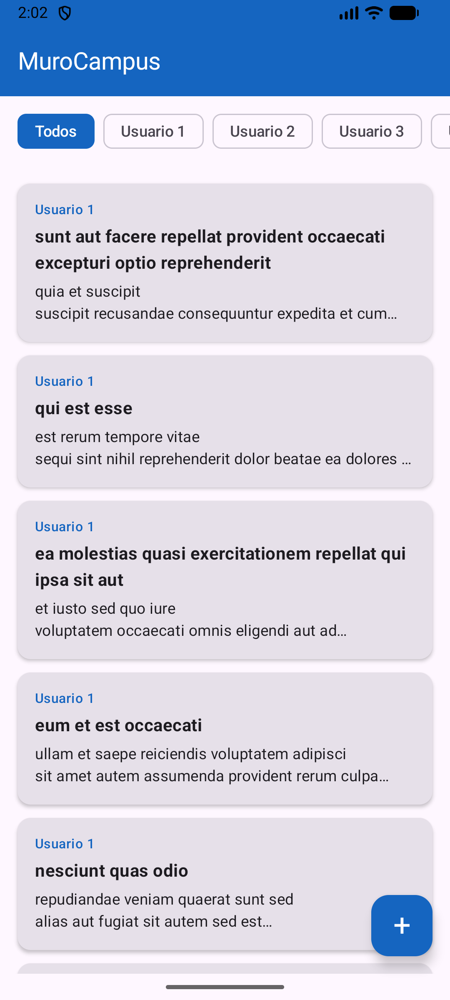
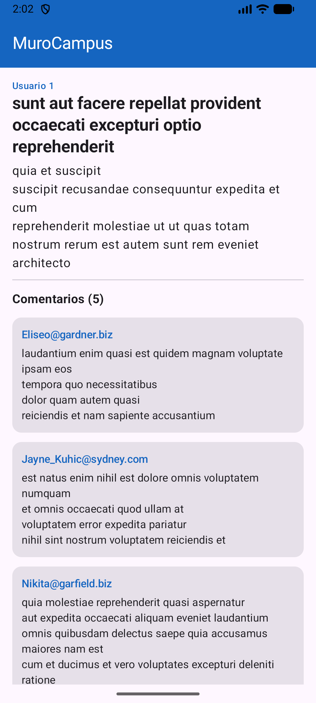
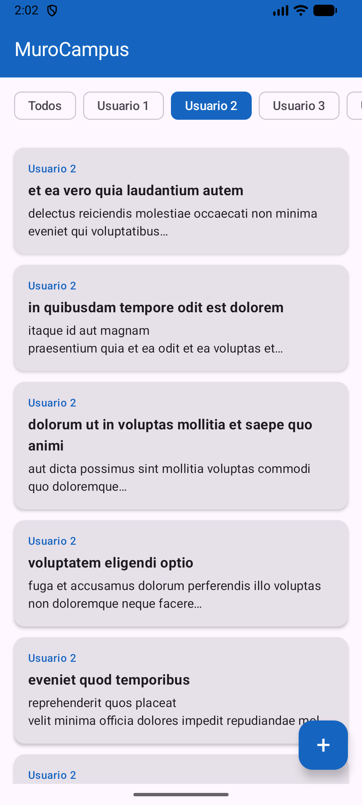
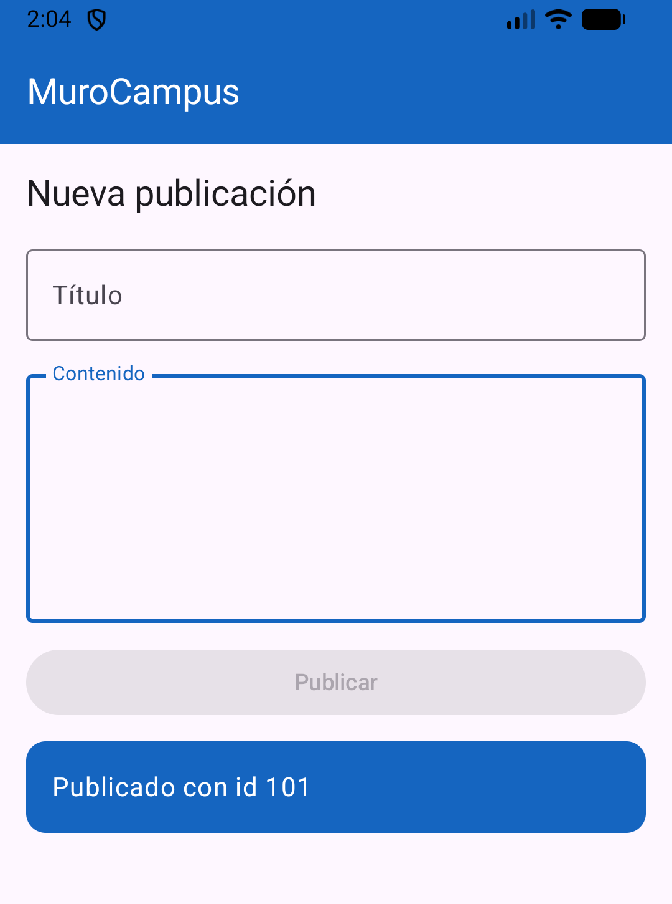
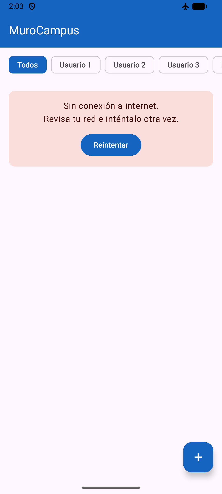

# MuroCampus

App de Android que consume un servicio web REST ([JSONPlaceholder](https://jsonplaceholder.typicode.com/)): lista publicaciones, muestra el detalle con sus comentarios, filtra por usuario y crea una publicación nueva. Cuando no hay internet o el servidor responde con error, la app no se cierra: muestra el mensaje y un botón **Reintentar**.

**Tecnología:** Kotlin + Jetpack Compose + Material 3, Retrofit, OkHttp, kotlinx.serialization, corrutinas y ViewModel
**Patrón:** MVVM + Repository (interface)
**Paquete:** `com.ramos.murocampus`

## Estructura de paquetes

```
com.ramos.murocampus/
├── MainActivity.kt                 navegación entre lista, detalle y crear
├── model/
│   └── Modelos.kt                  Post, Comentario, NuevoPost y Usuario
├── data/
│   ├── remote/
│   │   ├── PostApi.kt              interface de Retrofit (@GET, @POST, @Path, @Query, @Body)
│   │   └── RetrofitClient.kt       Retrofit + OkHttp + conversor JSON
│   └── PostRepository.kt           interface + PostRepositoryRemote (devuelve Result)
├── viewmodel/
│   ├── UiState.kt                  Cargando / Exito / Error y mensajeDe()
│   ├── PostsViewModel.kt           lista, detalle, filtro y crear
│   └── PostsViewModelFactory.kt
└── ui/
    ├── Componentes.kt              TarjetaPost, Cargando y ErrorConReintento
    ├── PantallaLista.kt            chips de usuario + lista
    ├── PantallaDetalle.kt          publicación y comentarios
    ├── PantallaCrear.kt            formulario Título / Contenido
    └── theme/
```

## Arquitectura MVVM + Repository

```
View (PantallaLista, PantallaDetalle, PantallaCrear)
   |  eventos: cargar, abrir, filtrar, publicar     ^  collectAsStateWithLifecycle()
   v                                                |
ViewModel (PostsViewModel) --- StateFlow<UiState> (Cargando / Exito / Error) --->
   |  viewModelScope.launch
   v
PostRepository (interface)  <- devuelve Result<...>
   -> PostRepositoryRemote  (captura IOException, HttpException...)
   |
   v
PostApi (Retrofit) --- OkHttp ---> https://jsonplaceholder.typicode.com/
```

| Capa | Conoce a | No hace |
|---|---|---|
| View (`ui/`) | Solo a su ViewModel | No llama a Retrofit ni a la API |
| ViewModel | Solo a la interface `PostRepository` | No usa Retrofit, `PostApi`, `HttpException` ni `Context` |
| Repository | `PostApi` y las excepciones de red | No conoce la UI y no deja escapar excepciones: devuelve `Result` |
| `data/remote` | Retrofit, OkHttp y el JSON | No guarda estado de pantalla |

## Endpoints usados

| Para... | Verbo y ruta | Función |
|---|---|---|
| Listar publicaciones | `GET posts` | `listar()` |
| Ver una publicación | `GET posts/{id}` | `detalle(@Path id)` |
| Ver sus comentarios | `GET posts/{id}/comments` | `comentarios(@Path id)` |
| Filtrar por usuario | `GET posts?userId=2` | `porUsuario(@Query userId)` |
| Crear una publicación | `POST posts` con JSON | `crear(@Body nuevo)` |

## Pruebas de errores (Paso 10)

| Prueba | Cómo se provocó | Resultado | OK |
|---|---|---|---|
| Sin internet | Modo avión y abrir la app | «Sin conexión a internet» y botón Reintentar | ✅ |
| Reintentar | Quitar el modo avión y pulsar Reintentar | Carga la lista | ✅ |
| Recurso inexistente | Pedir `posts/9999` en el detalle (temporal) | «Error del servidor (404)» | ✅ |
| JSON inesperado | Agregar a `Post` un campo que no llega (temporal) | «Respuesta inesperada» | ✅ |
| Cancelación | Abrir el detalle y volver rápido | Sin errores en Logcat (la carga anterior se cancela) | ✅ |
| Lista y detalle | Abrir varias publicaciones | Siempre 5 comentarios | ✅ |
| Filtro | Elegir Usuario 2 | 10 publicaciones, URL `posts?userId=2` | ✅ |
| Crear | Enviar una publicación | «Publicado con id 101», respuesta 201 | ✅ |
| Código | Revisar `viewmodel/` | Sin Retrofit, `PostApi` ni `HttpException` en el ViewModel | ✅ |

Los cambios temporales de las pruebas se deshicieron antes del commit.

## Capturas

| Lista | Detalle |
|---|---|
|  |  |

| Filtro por usuario | Crear publicación |
|---|---|
|  |  |

| Error de conexión |
|---|
|  |

## Para pensar

**1. ¿Qué diferencia hay entre GET y POST? ¿Por qué crear lleva @Body y porUsuario lleva @Query?**
`GET` **lee** datos y no cambia nada en el servidor; `POST` **envía** datos para crear un recurso nuevo. `crear` lleva `@Body` porque manda un objeto completo (`NuevoPost`) como JSON en el cuerpo de la petición. `porUsuario` lleva `@Query` porque solo agrega un filtro a la URL (`posts?userId=2`) y un GET no lleva cuerpo.

**2. ¿Por qué la ruta es "posts" y no "/posts"?**
Porque Retrofit une la ruta con la `baseUrl`. Si la ruta empieza con `/`, se toma como ruta absoluta y **reemplaza** el camino de la URL base. Con `"posts"` se agrega al final de `https://jsonplaceholder.typicode.com/`, que por eso termina en `/`.

**3. ¿Por qué el Repository devuelve Result en vez de dejar que la excepción llegue al ViewModel?**
Porque así ningún error de red puede cerrar la app: el Repository siempre responde «salió bien, aquí están los datos» o «salió mal, este es el error». El ViewModel solo transforma ese `Result` en un `UiState` con `onSuccess` y `onFailure`, sin `try/catch` y sin conocer `IOException` ni `HttpException`. Además, la `CancellationException` se relanza para no romper la cancelación de las corrutinas.

**4. ¿Qué pasa si olvidas el permiso INTERNET? ¿Y si olvidas ignoreUnknownKeys y el servidor agrega un campo nuevo?**
Sin el permiso `INTERNET` la app compila, pero nunca se conecta: toda llamada falla y se ve el error de red aunque el celular tenga internet. Sin `ignoreUnknownKeys = true`, si el servidor agrega un campo que no está en la data class, kotlinx.serialization lanza `SerializationException` y la app muestra «Respuesta inesperada».

**5. ¿Por qué la pantalla de lista usa un when sobre UiState y no un if con tres variables?**
Con un `sealed interface` la pantalla solo puede estar en **un** estado a la vez, y el `when` obliga a cubrir los tres casos (el compilador avisa si falta uno). Con tres variables (`cargando`, `datos`, `error`) podrían quedar combinaciones imposibles, como cargando y error al mismo tiempo, y habría que acordarse de limpiarlas a mano.

**6. JSONPlaceholder no guarda los POST. ¿Cómo cambiaría tu app si usaras un servicio real?**
Después de un POST exitoso la publicación sí existiría en el servidor, así que habría que **recargar la lista** (o agregar el post devuelto a la lista actual) para verla. También habría que manejar autenticación (token en un encabezado), validar los errores que devuelva el servidor (400, 401, 500) y, si se quiere funcionar sin internet, guardar una copia en Room para que el Repository decida si usa la red o la base de datos.
