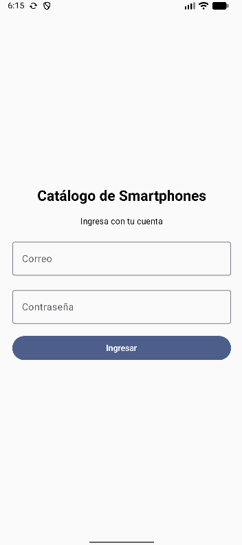
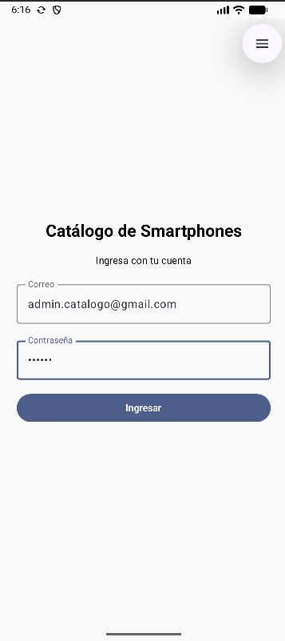
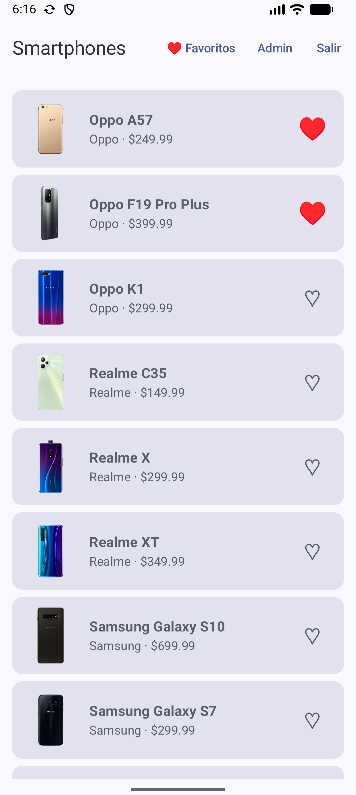
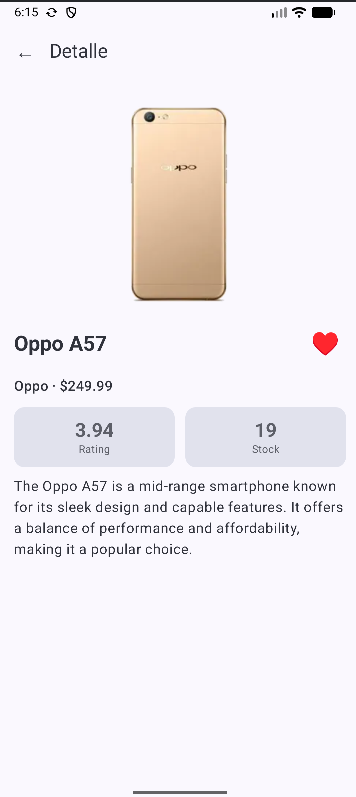
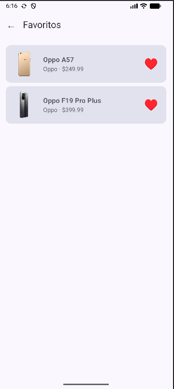
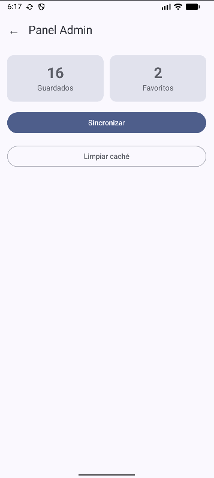

# Catálogo de Smartphones

App Android en **Kotlin + Jetpack Compose + Material 3** que muestra un catálogo de smartphones descargado de internet, lo guarda en el celular para usarlo sin conexión, permite marcar favoritos y tiene dos tipos de usuario: **usuario** y **admin**.

Integra las cuatro tecnologías del laboratorio siguiendo el patrón **MVVM**: **Retrofit**, **Room**, **Firebase Authentication + Firestore** y **notificaciones locales**.

| Dato | Detalle |
|---|---|
| Curso | Programación en Móviles · Laboratorio 11-12 |
| Docente | Juan León S. |
| Tema | Productos |
| Variante | Categoría `smartphones` |
| API | [dummyjson.com](https://dummyjson.com) (pública, sin clave) |
| Paquete | `com.tecsup.catalogo` |
| minSdk | 26 |
| Ramas | `main` (Fase 1, sin IA) · `mejora-ia` (Fase 2, con IA) |

## Qué puede hacer cada rol

| Función | Usuario | Admin |
|---|---|---|
| Ingresar con correo y contraseña | Sí | Sí |
| Ver lista y detalle | Sí | Sí |
| Marcar favoritos y ver Favoritos | Sí | Sí |
| Cerrar sesión | Sí | Sí |
| Panel Admin: totales, Sincronizar y Limpiar caché | No | Sí |

El rol **no se decide en la app**: se guarda en Firestore (`usuarios/{uid}` con el campo `rol`) y la app lo lee después de ingresar.

## Requisitos cumplidos

| Cód. | Requisito | Dónde está |
|---|---|---|
| R01 | Login con correo y contraseña, valida campos vacíos y muestra el error | `ui/login/` · `data/auth/FirebaseAuthRepository.kt` |
| R02 | Dos roles guardados en Firestore | `FirebaseAuthRepository.leerSesion()` · `ui/navigation/AppNav.kt` |
| R03 | Lista con Cargando, Error (con Reintentar) y Vacío | `ui/lista/` · `ui/components/` |
| R04 | Detalle con el segundo endpoint | `ui/detalle/` · `ApiService.detalle()` |
| R05 | MVVM con `UiState`, `ViewModel` y `Repository` como interface | `ui/UiState.kt` · `data/repository/ItemRepository.kt` |
| R06 | Room: Entity, Dao y Database | `data/local/` |
| R07 | Favoritos que se conservan al cerrar la app y al sincronizar | `ItemDao.idsFavoritos()` · `ItemRepositoryImpl.refrescar()` |
| R08 | Modo sin conexión con aviso | `ListaViewModel.aviso` |
| R09 | Notificación «Se guardaron N elementos» con canal y permiso | `notification/NotificadorAndroid.kt` |
| R10 | Panel Admin con totales, Sincronizar y Limpiar caché | `ui/admin/` |
| R11 | Sesión que se mantiene al reabrir y botón Cerrar sesión | `LoginViewModel` · botón **Salir** |

## Arquitectura MVVM

```
┌──────────────────────────────┐
│  UI (Composables)            │   ui/
│  solo observan el estado     │   collectAsStateWithLifecycle()
└──────────────┬───────────────┘
               ▼
┌──────────────────────────────┐
│  ViewModel                   │   StateFlow<UiState<T>>
│  sin Context                 │   la notificación va por la interface Notificador
└──────────────┬───────────────┘
               ▼
┌──────────────────────────────┐
│  ItemRepository (interface)  │   data/repository/
│  AuthRepository (interface)  │   data/auth/
└──────────────┬───────────────┘
               ▼
   Retrofit ──► Room ──► UI          Room es la fuente única de verdad
   (dummyjson)  (catalogo.db)        Retrofit solo la actualiza
   Firebase Auth + Firestore         login y rol
```

**Tres modelos distintos**, convertidos en `data/mapper/Mappers.kt`:

```
ItemDto (API) ──aEntity()──► ItemEntity (Room) ──aModelo()──► Item (UI)
```

Los ViewModel se crean con un `ViewModelProvider.Factory` que recibe el `AppContainer`, donde se crean la API, la base de datos, los repositorios y el notificador.

## Estructura del proyecto

```
Catalogo/app/src/main/java/com/tecsup/catalogo/
├── MainActivity.kt
├── AppContainer.kt
├── data/
│   ├── remote/      ApiService.kt · RetrofitClient.kt · dto/ItemDto.kt
│   ├── local/       ItemEntity.kt · ItemDao.kt · AppDatabase.kt
│   ├── auth/        AuthRepository.kt · FirebaseAuthRepository.kt
│   ├── repository/  ItemRepository.kt · ItemRepositoryImpl.kt
│   └── mapper/      Mappers.kt
├── domain/model/    Item.kt · Sesion.kt
├── notification/    Notificador.kt · NotificadorAndroid.kt
└── ui/
    ├── navigation/  AppNav.kt
    ├── UiState.kt
    ├── login/       LoginScreen.kt · LoginViewModel.kt
    ├── lista/       ListaScreen.kt · ListaViewModel.kt
    ├── detalle/     DetalleScreen.kt · DetalleViewModel.kt
    ├── favoritos/   FavoritosScreen.kt · FavoritosViewModel.kt
    ├── admin/       AdminScreen.kt · AdminViewModel.kt
    ├── components/  Cargando.kt · ErrorView.kt · BotonFavorito.kt
    └── theme/
```

## API usada

| Uso | Método | URL |
|---|---|---|
| Lista | `GET` | `https://dummyjson.com/products/category/smartphones` |
| Detalle | `GET` | `https://dummyjson.com/products/{id}` |

La lista llega dentro de `{ "products": [...] }` y trae 16 smartphones.

## Cómo compilar

1. Clonar el repositorio y abrir la carpeta `semana-12/Catalogo` en Android Studio.
2. Colocar el archivo `google-services.json` dentro de `semana-12/Catalogo/app/`. Este archivo **no está en el repositorio** porque contiene la clave del proyecto de Firebase; se descarga desde la consola de Firebase o lo entrega el equipo.
3. **Sync Now**, luego **Clean** y **Rebuild**.
4. Ejecutar en un emulador con Google Play o en un celular con Android 8 o superior.
5. Al abrir la app por primera vez, permitir las notificaciones.

## Configurar Firebase

1. En [console.firebase.google.com](https://console.firebase.google.com/) crear un proyecto y registrar una app Android con el paquete `com.tecsup.catalogo`.
2. Descargar `google-services.json` y colocarlo en `app/`.
3. **Authentication → Método de acceso:** activar **Correo electrónico/contraseña**.
4. **Authentication → Usuarios:** crear un usuario admin y un usuario normal.
5. **Firestore Database:** crear la base de datos `(default)` y la colección `usuarios` con un documento por usuario. El **ID del documento es el UID** del usuario y tiene los campos:

| Campo | Tipo | Valor |
|---|---|---|
| `rol` | string | `admin` o `usuario` |
| `nombre` | string | Nombre que se mostrará |

6. **Firestore → Reglas:** pegar y publicar:

```
rules_version = '2';
service cloud.firestore {
  match /databases/{database}/documents {
    match /usuarios/{uid} {
      allow read: if request.auth != null && request.auth.uid == uid;
      allow write: if false;
    }
  }
}
```

Validar el rol en la app solo cambia lo que se muestra; lo que protege los datos son las reglas de Firestore.

## Usuarios de prueba

| Rol | Correo |
|---|---|
| Admin | `admin.catalogo@gmail.com` |
| Usuario | `usuario.catalogo@gmail.com` |

Las contraseñas no se publican en el repositorio; se entregan en la sustentación.

## Capturas

| Login | Ingreso del admin | Lista |
|---|---|---|
|  |  |  |

| Detalle | Favoritos | Panel Admin |
|---|---|---|
|  |  |  |

En la lista, el admin ve los botones **Favoritos**, **Admin** y **Salir**; el usuario normal solo ve **Favoritos** y **Salir**. Al sincronizar llega la notificación **«Datos actualizados · Se guardaron 16 elementos»**.

## Pruebas de aceptación

| Cód. | Caso | Resultado esperado |
|---|---|---|
| PA-01 | Ingresar con el usuario normal | Entra al catálogo y no ve el panel Admin |
| PA-02 | Ingresar con el admin | Entra al catálogo y ve el botón Admin |
| PA-03 | Contraseña incorrecta | Mensaje de error, no entra |
| PA-04 | Correo o clave vacíos | Muestra validación, no llama a Firebase |
| PA-05 | Primera apertura con internet | Cargando, luego la lista y la notificación |
| PA-06 | Tocar un producto | Detalle con datos de `products/{id}` |
| PA-07 | Marcar un favorito y cerrar la app | Al reabrir sigue en Favoritos |
| PA-08 | Modo avión con datos guardados | La lista se ve con el aviso de sin conexión |
| PA-09 | Modo avión sin datos | Error con botón Reintentar |
| PA-10 | Sincronizar después de marcar un favorito | El favorito no se pierde |
| PA-11 | Admin pulsa Limpiar caché | Lista vacía y totales en 0; al sincronizar vuelven |
| PA-12 | Cerrar sesión y reabrir la app | Vuelve al login |
| PA-13 | Girar la pantalla | No se pierde el estado ni se vuelve a descargar |
| PA-14 | Negar el permiso de notificaciones | La app funciona normal, sin avisos |

## Hitos (rama main)

| Hito | Commit |
|---|---|
| H1 | Proyecto base con Compose |
| H2 | Estructura MVVM y contratos |
| H3 | UiState y componentes Cargando y ErrorView |
| H4 | Lista con datos de prueba |
| H5 | ApiService, RetrofitClient e ItemDto |
| H6 | La lista consume dummyjson |
| H7 | Pantalla de detalle y navegación |
| H8 | Base de datos Room |
| H9 | Room como fuente de verdad |
| H10 | Favoritos |
| H11 | Modo sin conexión |
| H12 | Configurar Firebase |
| H13 | Login, sesión y cerrar sesión |
| H14 | Roles y panel Admin |
| H15 | Notificación local |
| H16 | README |
