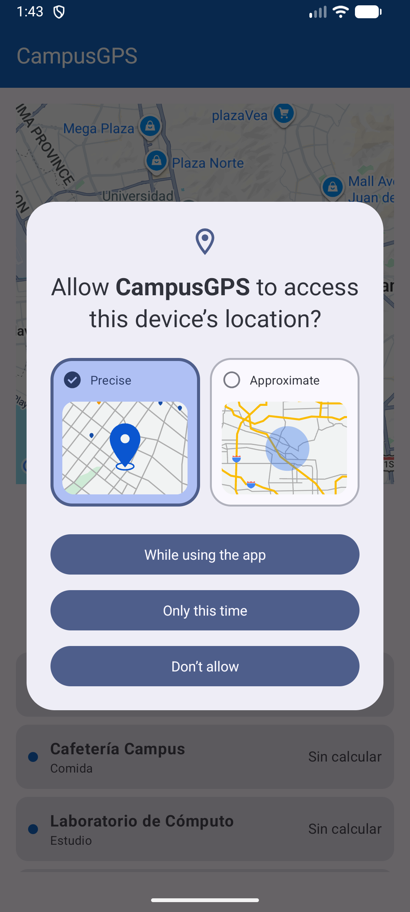
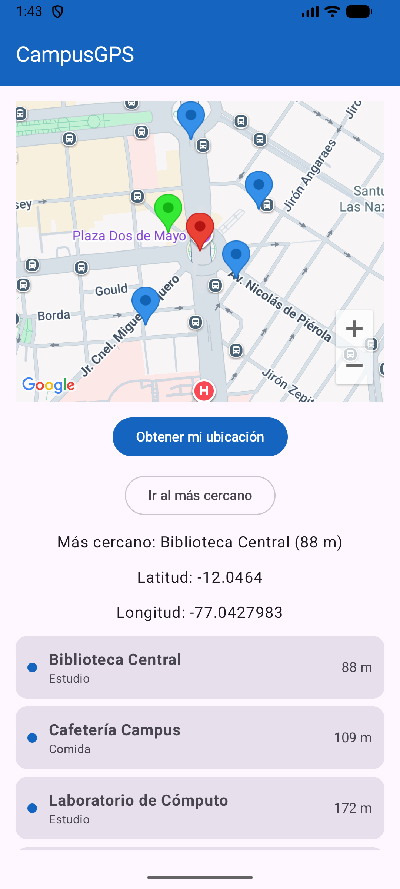
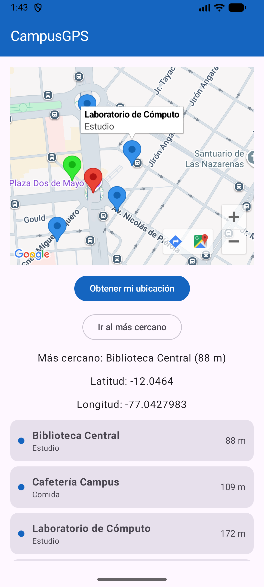
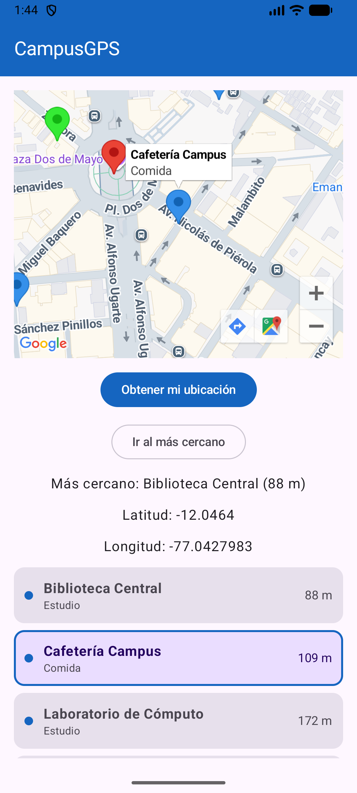
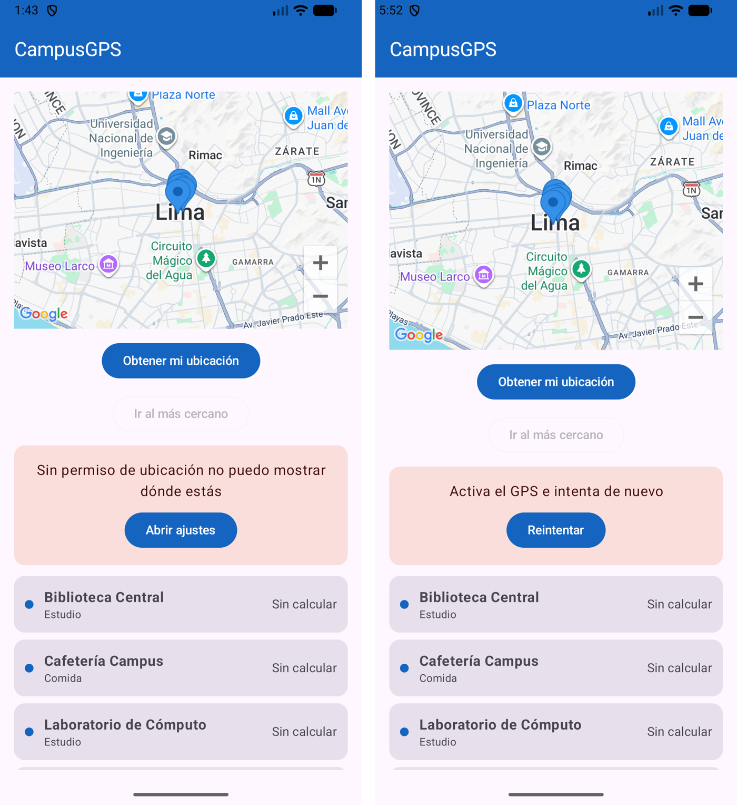

# CampusGPS

App Android en **Kotlin + Jetpack Compose + Material 3** que encuentra los puntos del campus más cercanos a ti. Pide el permiso de ubicación, obtiene tu posición con **FusedLocationProviderClient**, la muestra en un mapa con **Maps Compose**, calcula la distancia a cada lugar, ordena la lista del más cercano al más lejano y maneja los errores sin cerrarse.

| Dato | Detalle |
|---|---|
| Curso | Programación en Móviles · Laboratorio 13 |
| Docente | Juan León S. |
| Paquete | `com.ramos.campusgps` |
| minSdk | 26 |
| Patrón | MVVM + Repository (interface) |
| Librerías | Play Services Location, Maps Compose, Coroutines |
| Ramas | `main` (Fase 1, sin IA) · `mejora-ia` (Fase 2, con IA) |

## Cómo ejecutarlo

1. Crea una clave de **Maps SDK for Android** en Google Cloud, restringida al paquete `com.ramos.campusgps` y a tu SHA-1.
2. Agrégala en `local.properties` (este archivo no se sube a GitHub):
   ```properties
   MAPS_API_KEY=<tu clave de Maps>
   ```
3. Abre el proyecto en Android Studio, sincroniza Gradle y ejecútalo en un emulador con Google Play.
4. Pon el emulador en el punto base: **-12.0464, -77.0428**.

## Estructura de paquetes

```
com.ramos.campusgps
├── MainActivity.kt
├── model
│   └── Modelos.kt                    Posicion, Lugar, LugarConDistancia, TipoError, UbicacionUi
├── data
│   ├── UbicacionRepository.kt        interface: obtenerPosicion(), playServicesDisponible()
│   ├── UbicacionRepositoryGoogle.kt  FusedLocationProviderClient + GoogleApiAvailability
│   ├── LugaresRepository.kt          interface: obtenerLugares()
│   └── LugaresRepositoryLocal.kt     los 5 lugares fijos del campus
├── util
│   ├── Distancia.kt                  distanciaMetros() con Location.distanceBetween
│   └── Formato.kt                    formatearDistancia(): "350 m" o "1.5 km"
├── viewmodel
│   ├── MapaViewModel.kt              estado, lugares, seleccionado, masCercano
│   └── CampusViewModelFactory.kt     crea el ViewModel con sus repositorios
└── ui
    ├── PantallaMapa.kt               pantalla principal y permiso en tiempo de ejecución
    ├── MapaUbicacion.kt              GoogleMap, cámara y marcadores
    ├── ListaLugares.kt               LazyColumn de tarjetas con la distancia
    ├── MensajeError.kt               mensaje y botón según el TipoError
    └── theme/                        colores, tipografía y tema
```

## Arquitectura MVVM

```
View (PantallaMapa, MapaUbicacion, ListaLugares, MensajeError)
    |  evento: pulsar un botón o una tarjeta      ^  collectAsState()
    v                                             |
ViewModel (MapaViewModel) ---- StateFlow ---------+
    |  estado: Inicial / Buscando / Lista / Error
    |  lugares ordenados, seleccionado, masCercano
    v
UbicacionRepository  --->  UbicacionRepositoryGoogle (FusedLocationProviderClient)
LugaresRepository    --->  LugaresRepositoryLocal (5 lugares fijos)
```

| Capa | Conoce a | No hace |
|---|---|---|
| View (`ui/`) | Solo a su ViewModel | No usa Repository ni calcula distancias |
| ViewModel | Las interfaces de los Repository | No recibe `Context` ni dibuja nada |
| Repository | Google Play Services y los datos | No conoce la interfaz |

## Capturas

| 1. Permiso | 2. Mapa con mi ubicación | 3. Marcadores |
|---|---|---|
|  |  |  |
| Al pulsar el botón por primera vez, Android muestra el cuadro de permiso. | La cámara viaja a mi posición: marcador rojo **Estás aquí**, lugares en azul y el más cercano en verde. | Al tocar un marcador azul se ven el nombre y la categoría del lugar. |

| 4. Lista ordenada | 5. Error |
|---|---|
|  |  |
| Lista ordenada por distancia. Al tocar **Cafetería Campus**, la tarjeta se resalta y el mapa viaja hasta ella. | La app no se cierra. Izquierda: permiso negado con **Abrir ajustes**. Derecha: GPS apagado con **Reintentar**. |

Distancias medidas en el punto base: Biblioteca Central 88 m, Cafetería Campus 109 m, Laboratorio de Cómputo 172 m, Auditorio Principal 220 m y Estacionamiento Norte 266 m.

## Pruebas de aceptación

| Prueba | Resultado |
|---|---|
| Abrir la app y pulsar el botón | Aparece el cuadro de permiso ✅ |
| Aceptar el permiso | Se ven latitud, longitud y el marcador Estás aquí ✅ |
| Negar el permiso | Mensaje con Abrir ajustes, la app no se cierra ✅ |
| Ubicación en el punto base | Los 5 marcadores azules aparecen cerca ✅ |
| Tocar un marcador | Se ven el nombre y la categoría ✅ |
| Lista de lugares | Ordenada de menor a mayor, con m o km ✅ |
| Tocar una tarjeta | La cámara viaja al lugar y la tarjeta se resalta ✅ |
| Ir al más cercano | La cámara va al lugar verde; antes de buscar el botón está desactivado ✅ |
| Cambiar la ubicación y buscar otra vez | Cambian las distancias, el orden y el lugar verde ✅ |
| Ubicación apagada | Mensaje de GPS con Reintentar ✅ |
| Rotar la pantalla | No se pierden la ubicación ni la lista ✅ |
| Revisar el repositorio | La clave no está en el repositorio y `local.properties` no se sube ✅ |

## Para pensar

**1. ¿Por qué FusedLocationProviderClient está dentro del Repository y no en el ViewModel?**
Porque necesita un `Context` y depende de Google Play Services, que son detalles de Android. Si estuviera en el ViewModel, este quedaría atado al sistema, podría filtrar el `Context` de la Activity y sería difícil de probar. En el Repository queda detrás de una interface: el ViewModel solo llama a `obtenerPosicion()` y no le importa de dónde sale la ubicación. Así se puede cambiar por otra fuente, o por una falsa en las pruebas, sin tocar el ViewModel.

**2. ¿Qué diferencia hay entre el permiso de ubicación y la clave de API de Maps? ¿Qué pasa si falta cada uno?**
El permiso lo da **el usuario** y deja que la app lea el GPS del celular. La clave la da **Google Cloud** e identifica a mi app para poder descargar el mapa. Si falta el permiso, el mapa se ve, pero la app no sabe dónde estoy: muestra el mensaje con Abrir ajustes. Si falta la clave, o está mal restringida, la ubicación sí funciona, pero el mapa sale gris y en Logcat aparece un error de autorización.

**3. ¿Por qué la clave va en local.properties y no en el código? ¿Qué harías si se subiera a GitHub por error?**
`local.properties` está en `.gitignore`, así que la clave nunca llega al repositorio. Gradle la lee y la pone en el Manifest con `manifestPlaceholders`. Si estuviera en el código, cualquiera que viera el repositorio podría usarla y gastar mi cuota. Si se subiera por error, la borraría o regeneraría en Google Cloud porque ya no es segura, crearía una nueva con restricción de paquete y SHA-1, la guardaría solo en `local.properties` y quitaría la anterior del historial.

**4. ¿Dónde calculas la distancia y por qué no en el Composable?**
En el ViewModel, con la función privada `actualizarDistancias()`, que usa `distanciaMetros()` de `util/`. Solo se llama cuando llega la ubicación con éxito. No va en el Composable porque este se vuelve a dibujar muchas veces y repetiría el cálculo, y porque la View solo debe mostrar el estado. Así el cálculo y el orden quedan en un solo lugar, sobreviven a la rotación y se pueden probar.

**5. ¿Qué pasa con tu app si el usuario niega el permiso dos veces? ¿Cómo lo manejas?**
Desde Android 11, si el usuario niega el permiso dos veces, el sistema ya no vuelve a mostrar el cuadro y el launcher responde "denegado" al instante. La app no se cierra: llama a `vm.permisoDenegado()` y muestra el mensaje con el botón **Abrir ajustes**. Ese botón abre la pantalla de la app con `Settings.ACTION_APPLICATION_DETAILS_SETTINGS` para que el usuario active el permiso a mano. Cuando vuelve y pulsa el botón, `checkSelfPermission` ve el permiso concedido y busca la ubicación.

## Commits de la Fase 1

| N | Mensaje |
|---|---|
| 1 | chore: importa proyecto base CampusGPS |
| 2 | chore: configura permisos y clave de Maps con local.properties |
| 3 | feat(ubicacion): pide permiso de ubicacion en tiempo de ejecucion |
| 4 | feat(mapa): muestra mapa con marcador de la ubicacion actual |
| 5 | feat(mapa): agrega marcadores de los lugares del campus |
| 6 | feat(distancia): calcula y ordena lugares por distancia |
| 7 | feat(ui): agrega lista de lugares y seleccion en el mapa |
| 8 | feat(ui): resalta y navega al lugar mas cercano |
| 9 | feat(errores): maneja permiso denegado, GPS apagado y sin Play Services |
| 10 | docs: agrega README con estructura y capturas |
