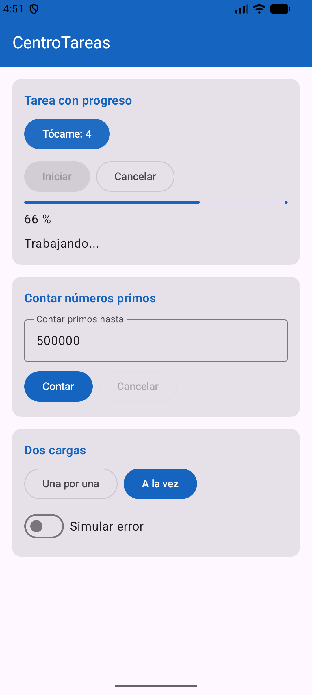
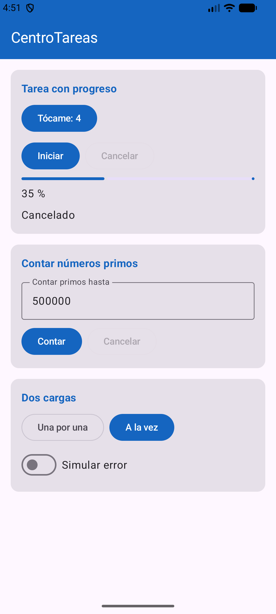
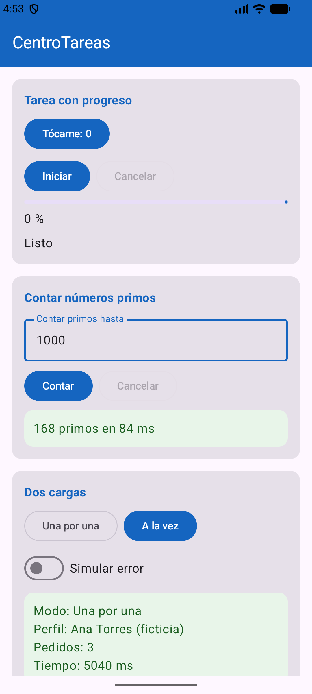
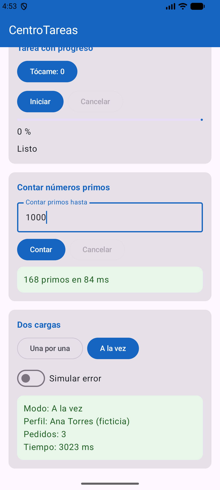
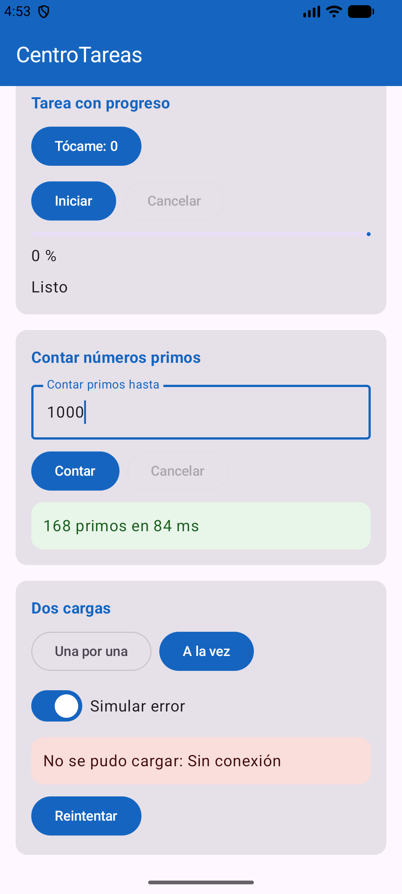

# CentroTareas

App de Android que hace tres tareas que tardan (una tarea con barra de progreso, un cálculo pesado de números primos y dos cargas de datos simuladas) sin congelar nunca la pantalla. Primero muestra el problema de bloquear el hilo principal y luego lo resuelve con corrutinas.

**Tecnología:** Kotlin + Jetpack Compose + Material 3, corrutinas y ViewModel
**Patrón:** MVVM + Repository (interface)
**Paquete:** `com.ramos.centrotareas`

## Estructura de paquetes

```
com.ramos.centrotareas/
├── MainActivity.kt
├── model/
│   └── Estados.kt                  PrimosUi y CargaUi
├── data/
│   ├── TareasRepository.kt         interface
│   └── TareasRepositoryLocal.kt    cargas simuladas y contarPrimos
├── viewmodel/
│   ├── TareasViewModel.kt          corrutinas, Job, async y estados
│   └── TareasViewModelFactory.kt
└── ui/
    ├── PantallaTareas.kt           las tres tarjetas
    └── theme/
```

## Arquitectura MVVM

```
View (PantallaTareas)
   |  eventos: botones            ^  collectAsState()
   v                              |
ViewModel (TareasViewModel) --- StateFlow --->
   |  viewModelScope.launch { ... }
   v
TareasRepository (interface) ---> TareasRepositoryLocal
                                  (cargas simuladas y contar primos)
```

| Capa | Conoce a | No hace |
|---|---|---|
| View (`ui/`) | Solo a su ViewModel | No lanza corrutinas ni usa `Thread`; solo muestra el estado y avisa los eventos |
| ViewModel | Solo a la interface del Repository | No conoce Composables, no recibe `Context` y no bloquea el hilo principal |
| Repository | Nada de la UI | No expone estados de pantalla; sus funciones `suspend` no bloquean el hilo que las llama |

## Observación del Paso 1

Al pulsar **Tarea larga (MAL)** la pantalla se congela durante 4 segundos: el contador **Tócame** no suma y ningún botón responde.

No se llega a ver **Trabajando...** porque `Thread.sleep(4000)` bloquea el hilo principal, que es el mismo que dibuja la pantalla. El texto cambia en el estado, pero Android no puede redibujar hasta que termina la espera, y para entonces el mensaje ya es **Terminó**.

Si la espera fuera de 10 segundos, Android mostraría el aviso **"La aplicación no responde" (ANR)**, con las opciones de esperar o cerrar la app.

## Capturas

| Tarea con progreso | Tarea cancelada |
|---|---|
|  |  |

| Primos | Una por una contra a la vez |
|---|---|
|  |  |

| Error simulado |
|---|
|  |

## Para pensar

**1. ¿Por qué no se veía Trabajando... en el Paso 1?**
Porque `Thread.sleep` bloqueó el hilo principal, que es el que dibuja la pantalla. El estado cambió a "Trabajando...", pero Android no pudo redibujar hasta que terminó la espera, y en ese momento el mensaje ya era "Terminó".

**2. ¿Qué diferencia hay entre Thread.sleep y delay?**
`Thread.sleep` **bloquea** el hilo: nadie más puede usarlo mientras espera. `delay` **suspende** la corrutina: la pausa, libera el hilo para que haga otras cosas y la continúa cuando pasa el tiempo. Además, `delay` revisa la cancelación; `Thread.sleep` no.

**3. ¿Por qué Dispatchers.Default para los primos y Dispatchers.IO para la red?**
Contar primos es trabajo de **procesador**, y `Default` tiene tantos hilos como núcleos tiene el celular. La red y el disco pasan casi todo el tiempo **esperando** una respuesta, y `IO` tiene muchos más hilos pensados para esas esperas sin desperdiciar procesador.

**4. ¿Qué pasaría con la corrutina si el usuario cierra la pantalla? ¿Qué papel cumple viewModelScope?**
`viewModelScope` está atado a la vida del ViewModel. Si el usuario solo gira la pantalla, el ViewModel sobrevive y la tarea continúa. Si cierra la pantalla, el ViewModel se destruye y `viewModelScope` **cancela automáticamente** todas sus corrutinas, así no quedan tareas trabajando ni gastando memoria.

**5. ¿Por qué async tarda 3 s y no 5 s? ¿Qué pasa si una de las dos cargas falla?**
Con `async` las dos cargas empiezan **al mismo tiempo**, así que el total es el de la más lenta: máximo(2 s, 3 s) ≈ 3 s. Una por una se suman: 2 s + 3 s ≈ 5 s. Si una falla dentro de `coroutineScope`, se **cancela la otra** y el error sube al `try/catch` del ViewModel, que muestra el recuadro rojo con **Reintentar**.
