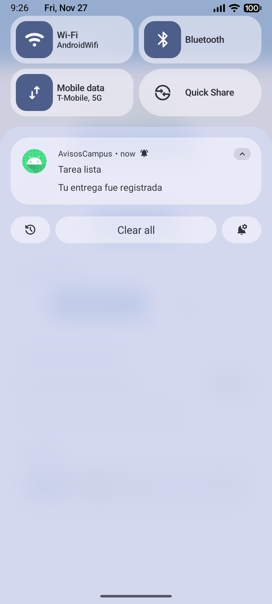
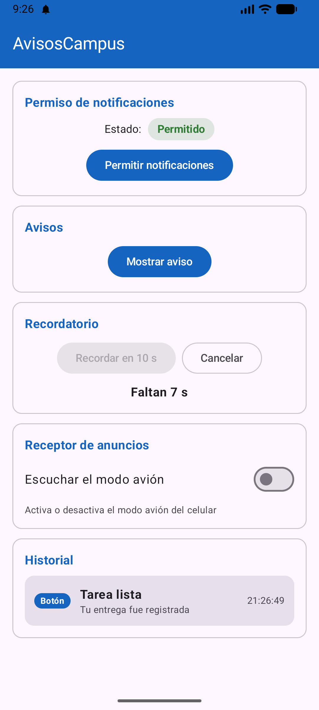
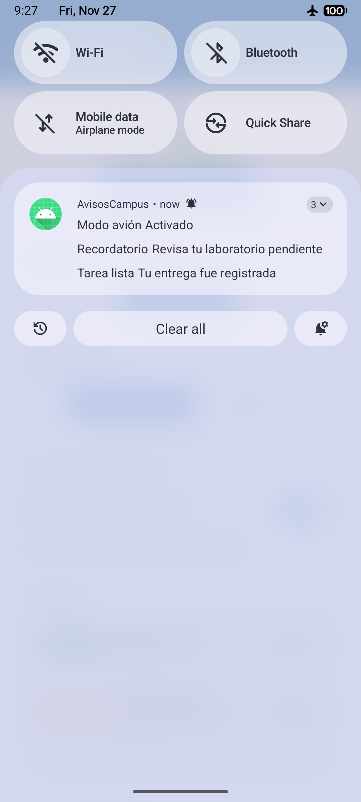
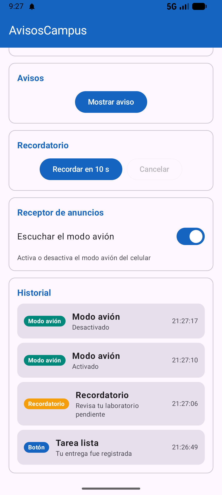
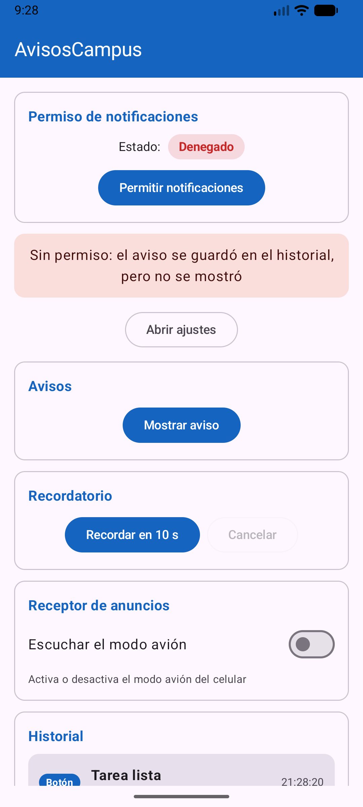

# AvisosCampus

App de Android que muestra notificaciones y escucha lo que pasa en el celular. Con un botón muestra un aviso, con otro programa un recordatorio que llega a los 10 segundos, y puede avisar cuando el usuario activa o desactiva el modo avión. Todo queda anotado en un historial.

**Tecnología:** Kotlin + Jetpack Compose + Material 3, notificaciones locales y BroadcastReceiver
**Patrón:** MVVM + Repository (interface)
**Paquete:** `com.ramos.avisoscampus`

## Estructura de paquetes

```
com.ramos.avisoscampus/
├── AvisosApp.kt                    Application: crea el canal
├── MainActivity.kt
├── model/
│   └── Modelos.kt                  Aviso, Origen y PermisoUi
├── data/
│   └── AvisosRepository.kt         interface + AvisosRepositoryMemoria
├── notificacion/
│   └── Notificador.kt              canal, permiso y mostrar
├── receiver/
│   └── ModoAvionReceiver.kt        escucha ACTION_AIRPLANE_MODE_CHANGED
├── viewmodel/
│   ├── AvisosViewModel.kt          decide qué avisar, recordatorio y escucha
│   └── AvisosViewModelFactory.kt
└── ui/
    ├── PantallaAvisos.kt           las tarjetas, permiso y receptor
    ├── HistorialAvisos.kt          lista de avisos
    └── theme/
```

## Arquitectura MVVM

```
View (PantallaAvisos)
   |  eventos: botones, switch            ^  collectAsState()
   v                                      |
ViewModel (AvisosViewModel) --- StateFlow (avisos, permiso, faltan, mensaje) --->
   |  registra el aviso                   |  emite: eventos (SharedFlow<Aviso>)
   v                                      v
AvisosRepository (interface)          View recibe el evento y llama a
   -> AvisosRepositoryMemoria         Notificador.mostrar(context, aviso)
```

| Capa | Conoce a | No hace |
|---|---|---|
| View (`ui/`) | Solo a su ViewModel y al Notificador | No decide qué se avisa ni guarda el historial |
| ViewModel | Solo a la interface del Repository | No conoce Composables, no recibe `Context` y no muestra notificaciones |
| Repository | Nada de la UI | No usa `Context` |
| Notificador | El sistema (canal y `NotificationManager`) | No guarda estado de la app |

## Pruebas de aceptación

Probadas en un emulador con Android 16 (API 37).

| Prueba | Resultado esperado | OK |
|---|---|---|
| Ajustes → Apps → AvisosCampus → Notificaciones | Existe el canal Avisos | ✅ |
| Pulsar Permitir notificaciones | Aparece el cuadro de Android y la etiqueta cambia | ✅ |
| Pulsar Mostrar aviso | Aparece la notificación Tarea lista | ✅ |
| Pulsar Mostrar aviso dos veces | Aparecen dos notificaciones distintas | ✅ |
| Tocar la notificación | Se abre la app y la notificación desaparece | ✅ |
| Recordar en 10 s | Cuenta regresiva y aviso al llegar a 0 | ✅ |
| Recordar y minimizar la app | El aviso llega igual | ✅ |
| Recordar y cancelar | No llega ningún aviso | ✅ |
| Switch activado y cambiar el modo avión | Aviso Activado y luego Desactivado | ✅ |
| Switch desactivado y cambiar el modo avión | No hay aviso | ✅ |
| Permiso denegado y Mostrar aviso | Mensaje de error, aviso en el historial y la app no se cierra | ✅ |
| Rotar la pantalla durante el recordatorio | La cuenta regresiva continúa | ✅ |
| Revisar el código | No hay `Context` en `viewmodel/` y todo receptor registrado se quita en `onDispose` | ✅ |

## Capturas

| Notificación en el panel | Recordatorio |
|---|---|
|  |  |

| Modo avión | Historial |
|---|---|
|  |  |

| Permiso denegado |
|---|
|  |

## Para pensar

**1. ¿Por qué una notificación necesita un canal y un permiso? ¿Qué pasa si falta cada uno?**
Desde Android 8 cada notificación debe pertenecer a un **canal**, para que el usuario pueda decidir por tipo de aviso si quiere sonido, vibración o silenciarlo. Si el canal no existe, Android descarta la notificación y no se ve nada. Desde Android 13 además hace falta el **permiso** `POST_NOTIFICATIONS`, para que el usuario decida si la app puede avisarle. Sin el permiso la notificación tampoco aparece; por eso `mostrar` devuelve `false` y la app muestra el mensaje en vez de cerrarse.

**2. ¿Por qué el ViewModel emite un evento y no muestra la notificación él mismo?**
Para mostrar una notificación hace falta un `Context`, y el ViewModel no debe tenerlo: vive más que la pantalla y guardar un `Context` puede filtrar memoria. Además, así se puede probar sin Android. El ViewModel solo **decide** qué avisar, lo anota en el Repository y emite el aviso por un `SharedFlow`. La pantalla, que sí tiene `Context`, lo recibe y llama al `Notificador`.

**3. ¿Qué pasa si usas el mismo id en dos notificaciones?**
La segunda **reemplaza** a la primera: Android actualiza la notificación que ya tiene ese id en lugar de mostrar otra. Por eso se usa `aviso.id`, que es distinto en cada aviso, y al pulsar dos veces aparecen dos notificaciones.

**4. ¿Por qué onReceive debe ser corto y por qué hay que quitar el receptor al salir?**
`onReceive` se ejecuta en el hilo principal: si hace trabajo largo congela la pantalla, y si tarda demasiado Android lo da por colgado. Por eso solo lee el estado y llama a `alCambiar`. El receptor se quita con `unregisterReceiver` en `onDispose` porque, si se queda registrado, sigue guardando una referencia a la pantalla que ya no existe y se **filtra memoria**, además de seguir avisando cuando ya no debería.

**5. ¿En qué casos usarías una notificación local y en cuáles una push de Firebase?**
Una **notificación local** la crea la propia app con información que ya tiene: un recordatorio, una tarea terminada o un cambio del celular como el modo avión. Funciona sin internet. Una **push de Firebase** la envía un servidor cuando pasa algo fuera del celular: un mensaje nuevo, una nota publicada por el docente o una promoción. Llega aunque la app esté cerrada, pero necesita internet y un servidor.
